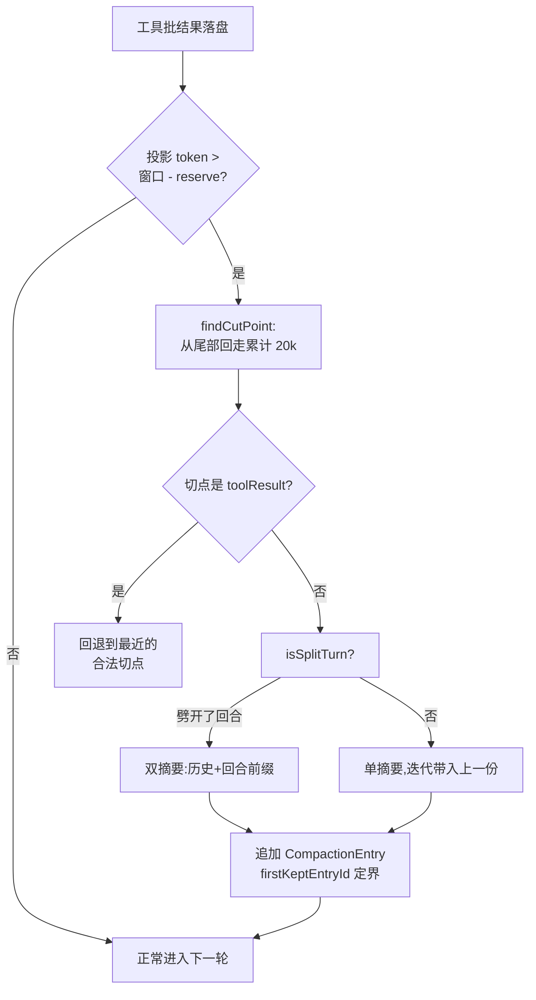
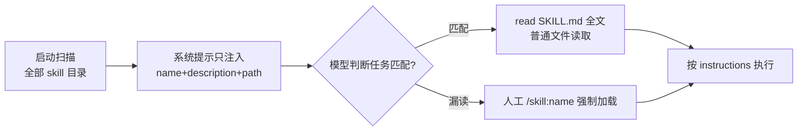
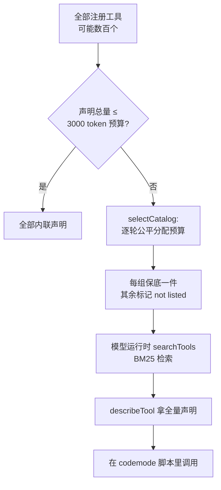
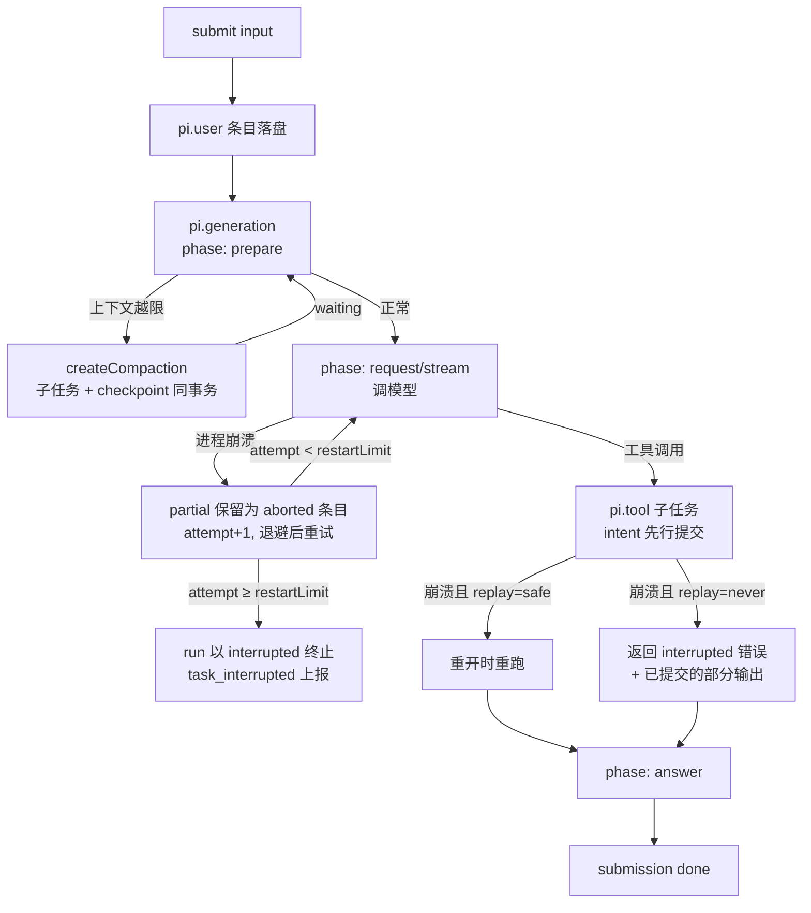
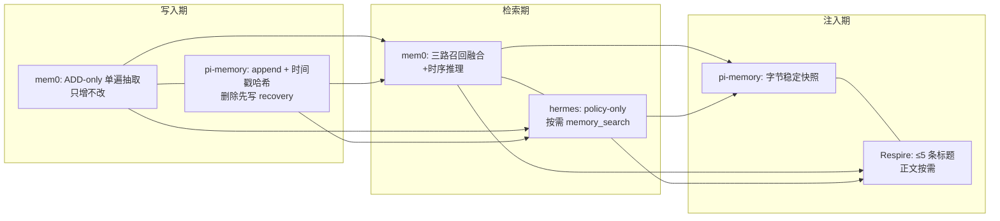
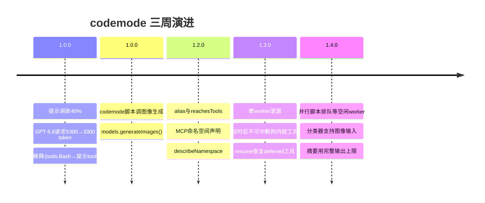
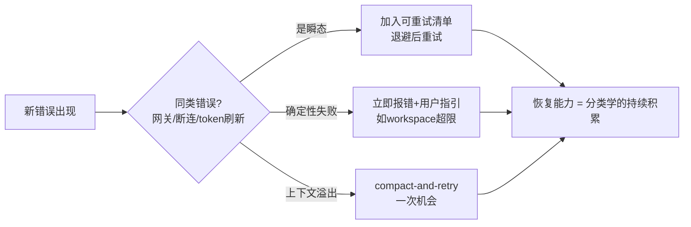

## 第 1 章 极简内核的哲学：一个 harness，不是一艘航母

**所有 agent 框架都在做加法，pi 在做减法。**

2026 年的主流叙事是"全能"：内置 sub-agent 编排、plan mode、任务看板、记忆库、插件市场，装完即得一个"企业级 agent 平台"。而 pi 的 README 亮出的立场几乎是反直觉的——它刻意不内置 sub-agents 和 plan mode，然后补了一句态度鲜明的话：

> Pi ships with powerful defaults but skips features like sub-agents and plan mode. **Ask Pi to build what you want**, or install a package that does it your way.

缺什么？让 agent 自己给你造，或者装一个别人造好的包。这句话就是 pi 的产品定义：**它不是一个开箱即全的 agent，而是一个让你把它改造成"你的 agent"的 harness。**


### 1.1 打开引擎盖：runLoop 的真实形状

不看源码的"极简"都是修辞。pi-agent-core 的 `agent-loop.ts` 全文 960 行，其中真正的循环只有一个函数——`runLoop`。把它压到骨架（保留真实控制流，注释是我加的）：

```typescript
async function runLoop(initialContext, newMessages, initialConfig, signal, emit, streamFn) {
  let currentContext = initialContext;
  let config = initialConfig;
  let pendingMessages = (await config.getSteeringMessages?.()) || [];

  while (true) {                                  // 外循环：follow-up 到来时续跑
    let hasMoreToolCalls = true;

    while (hasMoreToolCalls || pendingMessages.length > 0) {   // 内循环：一轮 = 一次模型响应 + 工具批
      // ① 上一轮结束后的准备钩子（压缩就在这里发生）
      if (lastCompletedTurn) {
        const nextTurnSnapshot = await config.prepareNextTurn?.(lastCompletedTurn);
        if (nextTurnSnapshot) {
          currentContext = nextTurnSnapshot.context ?? currentContext;
          preparedMessages = nextTurnSnapshot.messages ?? [];
          config = { ...config, model: nextTurnSnapshot.model ?? config.model, /* thinkingLevel 同步 */ };
        }
        // 准备可能耗时（比如压缩），补收这段时间里排队的 steering 消息
        if (pendingMessages.length === 0) {
          pendingMessages = (await config.getSteeringMessages?.()) || [];
        }
        await emit({ type: "turn_start" });
      }

      // ② 把准备消息和 steering 消息声明进上下文（含工具增减的系统补丁，见第2章）
      for (const message of declareToolChanges(currentContext, [...preparedMessages, ...pendingMessages])) {
        await emit({ type: "message_start", message });
        currentContext.messages.push(message);
        newMessages.push(message);
      }
      pendingMessages = [];

      // ③ 最后一次改写请求的机会
      const requestUpdate = await config.prepareRequest?.({ context: currentContext, model: config.model }, signal);

      // ④ 流式拿回助手响应
      const message = await streamAssistantResponse(currentContext, config, signal, emit, streamFn);

      // ⑤ 错误/中止是硬出口：直接结束 run
      if (message.stopReason === "error" || message.stopReason === "aborted") {
        await config.finishTurn?.(lastCompletedTurn, signal);
        await emit({ type: "turn_end", message, toolResults: [] });
        await emit({ type: "agent_end", messages: newMessages });
        return;
      }

      // ⑥ 执行工具批 → hasMoreToolCalls 决定是否再来一轮
      //    （工具并行执行、结果按 assistant 源顺序落盘，细节见第3章）
    }

    // ⑦ 自然停止点：看有没有排队的 follow-up
    const followUpMessages = (await config.getFollowUpMessages?.()) || [];
    if (followUpMessages.length > 0) { pendingMessages = followUpMessages; continue; }
    break;
  }
  await emit({ type: "agent_end", messages: newMessages });
}
```

值得盯住的三处细节，它们不是注释能写出来的工程决策：

- **steering 消息的收割时机**：`prepareNextTurn` 可能跑很久（压缩就是在这里），所以 ① 里特意补收了一次 steering——用户在压缩期间打的字不会丢到下一轮。这是"打断不丢消息"语义的实现现场；
- **`error`/`aborted` 是硬出口**：⑤ 处不进重试、不进下一轮，直接 `agent_end`。错误恢复被推到了外层（coding-agent 的重试分类、pi-durable 的任务恢复，第 4 章），loop 本体拒绝染指——**loop 只负责推进，不负责救火**；
- **外循环只为一件事存在**：follow-up（⑦）。run 自然结束后如果有排队的后续消息，直接续跑而不是结束再重启。整个"外循环"6 行代码，换来了"提交即排队"的编程模型。

### 1.2 上下文的两道变换：transformContext 与 convertToLlm

loop 拿到的 `AgentMessage[]` 不是发给 LLM 的东西。中间有两道变换，签名如下（源码直出）：

```typescript
// 可选：发给 LLM 前的最后改写机会（裁剪旧消息、注入外部上下文）
transformContext?: (messages: AgentMessage[], signal?: AbortSignal) => Promise<AgentMessage[]>;

// 必选：AgentMessage → LLM Message 的收敛
convertToLlm: (messages: AgentMessage[]) => Message[] | Promise<Message[]>>;
```

`AgentMessage` 是开放联合类型：除了 `user/assistant/toolResult`，还允许应用通过 declaration merging 塞进自定义 role（session 树上的 custom entry 就是为它们准备的）。`convertToLlm` 的职责是把模型看不懂的东西过滤或转写：

```typescript
// 官方文档给的实现示例
convertToLlm: (messages) => messages.flatMap(m => {
  if (m.role === "custom")   return [{ role: "user", content: m.content, timestamp: m.timestamp }];
  if (m.role === "notification") return [];    // UI-only 消息，直接丢弃
  return [m];                                  // 标准 LLM 消息原样通过
})
```

消息流水线全景：

```mermaid
flowchart LR
    A[AgentMessage[]<br/>开放联合类型] -->|transformContext<br/>可选: 裁剪/注入| B[AgentMessage[]]
    B -->|convertToLlm<br/>必选: 过滤/转写| C[Message[]<br/>user/assistant/toolResult]
    C --> D[LLM Provider]
    D -->|流式响应| E[AgentMessage 追加进树]
    E -->|下一轮| A
```

这个设计的深意在于**双出口**：`transformContext` 保持 AgentMessage 语义（你还能改树内的东西），`convertToLlm` 才坍缩到 LLM 语义。session 持久化的是前者，模型看到的是后者——第 2 章的 compaction、第 5 章的记忆注入，全部活在这条流水线的缝隙里。

### 1.3 分层：把"你能替换什么"写进代码结构

monorepo 的分层不是模块化审美，是替换边界的显式化：

- **pi-ai**：模型接入层。多 provider 流式调用、重试、模型目录，不含任何 agent 逻辑；
- **pi-agent-core**：1.1/1.2 看过的 loop 本体与消息类型；
- **pi-coding-agent**：CLI、默认工具集、session 管理、扩展系统；
- **pi-durable**：可恢复的持久化 harness（第 4 章主角）；
- **chord**：插件热重载宿主运行时与 RPC；
- **pi-tui**：终端 UI 组件。


对比大多数框架：主循环、工具调度、记忆、编排、UI 缠在一个 runtime 里，想换掉任何一层都得先读懂整个 runtime。pi 的赌注是：**只要 loop 足够小且边界干净，扩展就不再需要框架"支持"，而是天然可行。** SDK 示例从 20 行跑通一个 loop 到完全接管上下文组装，用的就是同一套 `Agent` 类和同一套钩子。

### 1.4 减法的杠杆：扩展点密度决定生态上限

极简不等于简陋。pi 把复杂度从"内置功能"转移到了"扩展点密度"上：

- **Extensions**：TypeScript 模块加载进 pi 进程，注册工具、命令、快捷键、provider、事件处理器、渲染器、终端 UI；
- **Skills**：按需加载的说明书——启动时只注入 name + description（Agent Skills 规范实现）；
- **Prompt templates / Themes**：输入侧与渲染侧的轻量定制；
- **Pi Packages**：以上资源的分发单元，npm/git 装包即用，pi.dev 维护公开目录。

数一下 npm 生态里的 pi 包：sub-agents、写沙箱、后台任务、SSH、记忆扩展、观测插件……README 里刻意不做的功能，社区全都补上了，而且不止一个实现。**"砍功能"砍出的空位，成了生态的生长点**：内置了，社区只能做"配置"；不内置，社区才能做"实现"。

### 1.5 一个 harness 的克制清单

| pi 不内置 | pi 交付 | 换来的 |
|---|---|---|
| sub-agents | 扩展点 + 包生态 | 多种实现方案竞争 |
| plan mode | 极小的核心 loop（1.1 的 60 行骨架） | 可整体替换的心智模型 |
| 记忆组件 | session 树 + custom entry + compaction | 记忆成为数据模型问题（第 5 章） |
| 权限系统 | 信任边界 + OS 权限复用 | 更少的抽象层 |

这就是传统软件几十年炼出来的纪律：**小内核、清晰边界、组合优于配置**。pi 是这套纪律在 agent harness 上的一个高质量落地。

### 本章要点

- `runLoop` 骨架 60 行：内循环跑"模型响应+工具批"，外循环只为 follow-up 存在；错误是硬出口，恢复责任在外层；
- 两道上下文变换（`transformContext` → `convertToLlm`）把"树内语义"和"LLM 语义"解耦，这是后续所有机制的地基；
- 极简是策略：小 loop + 高密度扩展点 = 生态生长空间。

---

## 第 2 章 上下文工程：session 树、compaction 与 prompt cache 的共舞

大多数 agent 的上下文管理是"一维"的：一条消息数组，满了就截断或摘要。pi 的出发点不同——**上下文的底层是一棵树，所有的上下文操作都应该是这棵树上的指针移动，而不是数据改写。** 这一个决定，同时解决了分支、压缩、缓存三个问题。


### 2.1 会话是一棵树，不是一个数组

Session 是 JSONL 文件，每个条目带 `id` 和 `parentId`，当前条目到根的路径就是**活跃分支**，它才是下一次模型请求的历史。条目基座（源码直出）：

```typescript
interface SessionEntryBase {
  type: string;
  id: string;              // 8 位 hex；冲突时回退完整 UUID
  parentId: string | null; // 根条目为 null
  timestamp: string;       // ISO 8601
}
```

三个直接后果：

- **分支零成本**：`/tree` 回到任意历史节点重新提交，旧分支原样保留在文件里——不是"撤销后重来"，是"另开一条路"；`/fork`/`/clone` 把分支物化为独立 session（header 里带 `parentSession` 指回原文件）；
- **改写即分支**：编辑旧消息重新提交，pi 不修改任何已有条目，只新建一条指向旧节点的子条目。历史完整性天然被保证；
- **离开分支不丢上下文**：切走时 pi 自动摘要被放弃的分支，把摘要挂到目标分支上——放弃路径，保留结论。

**每一步都只追加、只移动指针。** 这个性质是后面一切的地基：第 4 章的崩溃恢复 = 重放树路径；第 5 章的记忆 = 树上的 custom entry。

### 2.2 Compaction：在树上做精确手术

上下文逼近窗口时的自动压缩（`contextTokens > contextWindow - reserveTokens`，默认 reserve 16384），实现在 `compaction/compaction.ts`（全文 1105 行）。切点选择的真实算法：

```typescript
export function findCutPoint(entries, startIndex, endIndex, keepRecentTokens): CutPointResult {
  const cutPoints = findValidCutPoints(entries, startIndex, endIndex); // 合法切点集合

  // 从最新条目向回走，累加估算 token
  let accumulatedTokens = 0;
  let cutIndex = cutPoints[0];
  for (let i = endIndex - 1; i >= startIndex; i--) {
    const messageTokens = sessionEntryToContextMessages(entry).reduce(
      (sum, message) => sum + estimateTokens(message), 0);
    if (messageTokens === 0) continue;
    accumulatedTokens += messageTokens;
    if (accumulatedTokens >= keepRecentTokens) {        // 默认 20k
      // 取"该位置或之后"最近的合法切点；尾部工具结果自己超预算时，
      // 保留它前面的 assistant 工具调用，而不是退回第一条消息
      cutIndex = cutPoints.find((c) => c >= i) ?? cutPoints[cutPoints.length - 1];
      break;
    }
  }
  // 向前吞并不影响上下文的相邻元数据条目
  while (cutIndex > startIndex && isMetadataOnly(entries[cutIndex - 1])) cutIndex--;

  // 切点不是回合起点 → 这是"劈开了一个回合"
  const startsTurn = isTurnStartEntry(entries[cutIndex]);
  return {
    firstKeptEntryIndex: cutIndex,
    turnStartIndex: startsTurn ? -1 : findTurnStartIndex(entries, cutIndex, startIndex),
    isSplitTurn: !startsTurn && turnStartIndex !== -1,
  };
}
```

而"合法切点"的定义，是整个压缩安全性的核心：

```typescript
function isCutPointMessage(message: AgentMessage): boolean {
  switch (message.role) {
    case "user": case "assistant":
    case "bashExecution": case "custom":
    case "branchSummary": case "compactionSummary":
      return true;
    case "toolResult":
      return false;   // 铁律：永远不在工具结果处切——它必须和调用它的 tool call 待在一起
  }
  return false;
}
```

注意 `isSplitTurn`：当切点落在一个超长回合中间（一次用户提交引发的多轮工具调用），pi 会生成**两份摘要**——历史摘要 + 被劈开回合的前缀摘要——再合并，保证"正在进行的任务"不被拦腰斩断。

**摘要是条目，不是替换。** `CompactionEntry` 追加到树上：

```typescript
export interface CompactionEntry<T = unknown> extends SessionEntryBase {
  type: "compaction";
  summary: string;             // 结构化摘要（Goal/Done/In Progress/Key Decisions/Next Steps/Critical Context）
  firstKeptEntryId: string;    // 从哪个条目开始保留
  tokensBefore: number;
  usage?: Usage;               // 生成摘要这次 LLM 调用的开销也被记账
  fromHook?: boolean;          // 扩展生成的摘要（session_before_compact 钩子）
  systemMessage?: SystemMessage; // 压缩边界处的完整 prompt+工具状态快照
}
```

模型看到的是 `summary + firstKeptEntryId 之后的消息`，旧条目一个字节不动，你随时 `/tree` 回压缩前的完整历史。1.4.0 还修掉了一个隐蔽的坑：摘要请求原先有固定输出上限，推理模型把输出 token 烧在 thinking 上时摘要必然失败——现在摘要直接用模型的完整输出上限。

压缩时机在 1.1 节 `runLoop` 的 ① 处（`prepareNextTurn`）：工具批落盘后、下一次助手响应前检查投影 token，越线则先压缩再继续；provider 抛上下文溢出错误则触发一次 compact-and-retry。



### 2.3 补丁式系统消息：cache 保卫战的底层机制

这是 pi 上下文工程里最不显眼、却最能体现工程态度的一条线。先看机制，再看它在 changelog 里的账单。

session 的第一条系统消息持久化完整的 prompt 分区 + 工具清单；**之后的一切变化都以补丁形式追加**。实现就在 `agent-loop.ts` 的 `declareToolChanges`（每次请求前调用）：

```typescript
function declareToolChanges(context: AgentContext, pendingMessages: AgentMessage[]): AgentMessage[] {
  // 找 pending 里最后一条系统消息（可能有扩展预置的意图声明）
  const pending = /* ... */ pendingMessages[systemIndex] as SystemMessage | undefined;

  // baseline：把已有系统消息的工具字段清零，得到"已提交的 transcript 状态"
  const baseline = pending
    ? pendingMessages.map((m, i) => i === systemIndex ? withToolChanges(pending, NO_CHANGES) : m)
    : pendingMessages;

  // 差分：可执行工具集 vs transcript 已声明的集合
  const changes = getToolStateChanges(
    getCurrentTools([...context.messages, ...baseline]),   // transcript 说了什么
    (context.tools ?? []).map(toToolDeclaration),          // runtime 能执行什么
  );

  if (pending) {
    // 有预置系统消息：把差分写回它的 toolsAdded/toolsRemoved
    return baseline.map((m, i) => i === systemIndex ? withToolChanges(pending, changes) : m);
  }
  // 没有则插入一条新的补丁系统消息（放在第一条非 system 消息前）
  const update = withToolChanges({ role: "system", content: "", timestamp: Date.now() }, changes);
  return [...pendingMessages.slice(0, insertIndex), update, ...pendingMessages.slice(insertIndex)];
}
```

读一遍函数头注释的原话：**"Before each request the difference becomes `toolsAdded` and `toolsRemoved` on a system message... so replay always yields exactly `context.tools`."** ——重放补丁序列必然精确得到当前工具集，没有独立维护的"prompt 状态"，也就没有状态与历史不一致的缝隙。cache 视角：历史前缀永不改写，变化只发生在请求尾部。


这条纪律的账单，散布在 1.0→1.4 的 changelog 里：

- **1.0.1**：Anthropic 会话中途重定义同名工具改为对话内联定义——不再重发整个工具列表；
- **1.2.0**：修扩展触发的 run 在首次工具调用后丢失 system prompt 新增分区（"每次 run 破坏 cache 两次"）；`serializeConversation` 不再携带 thinking 块——重放的 thinking 不在活跃上下文里，带着它摘要请求会比被摘要的上下文还大；
- **1.3.0**：GPT-6 中途改 thinking level 保 cache；切模型丢弃旧模型 thinking（旧推理当正文发给新模型，还会教坏它）；resume 恢复会话期间激活的工具集（否则每次 resume 工具列表都变，cache 全毁）；Kimi Code 换官方 Chat Completions 协议，中途加工具不再清缓存；
- **1.4.0**：修"移除工具后 deferred 加载导致 OpenAI Responses 全量丢缓存"。

为什么值得做到这个程度？长会话里 cache 命中直接决定成本和延迟：一次 cache 失效等于把整个上下文按未命中价重算。**pi 把"不动历史前缀"当作和正确性同级的约束。**

### 本章要点

- 树是根：条目只追加，分支/压缩/恢复全是指针操作；切点铁律（`toolResult` 不可切）+ split-turn 双摘要是压缩的精确性所在；
- 补丁式系统消息（`declareToolChanges` 差分）是"改工具不破 cache"的实现现场：transcript 重放必得当前状态；
- cache 是隐形主线：1.0→1.4 十几条修复同属一条纪律——前缀即资产。

---

## 第 3 章 动态组装：skill 是"按需说明书"，tool 是"运行时积木"

skill 和 tool 都能"动态"，但它们的动态是两回事：**skill 的成本在内容，动态的是"何时读"；tool 的成本在执行与声明，动态的是"何时装"。** pi 对这两类资源给出了截然不同却同样彻底的方案，合起来才是完整的"上下文按需供给"。


### 3.1 Skill：目录与正文分离

pi 实现了 Agent Skills 规范，frontmatter 里与加载相关的关键字段：

```yaml
---
name: pdf-tools                    # 命令与显示名；小写字母/数字/连字符，≤64 字符
description: Extract text and tables from PDF files.   # 路由信息，≤1024 字符
disable-model-invocation: true     # 从模型视野隐藏，仅 /skill:name 可用
---
```

加载的两级结构：

- **启动时**：扫描全部 skill 目录（用户级、项目级、`.agents/skills/`、包贡献路径），只把 `name + description + 路径` 注入系统提示。description 是唯一的路由依据——"做什么 + 什么时候用"写不清的 skill 永远不会被选中；
- **运行时**：模型判断任务匹配后，自己用 read 工具读取 `SKILL.md` 全文。没有特殊通道，就是一次普通的文件读取。



这个"目录常驻、正文按需"的结构，把 skill 的常驻上下文成本压到一条 description——装几十个 skill 几乎不花 token 预算。**加载粒度从"功能"细化到了"说明书的一页"。**

更进一步的动态性：`resources_discover` 事件让扩展在运行时贡献新的 skill/prompt/theme 路径——skill 目录不必在启动前存在：

```typescript
pi.on("resources_discover", () => {
  return {
    skillPaths: [join(baseDir, "SKILL.md")],   // 可以是运行时生成/拉取的目录
    promptPaths: [join(baseDir, "dynamic.md")],
    themePaths: [join(baseDir, "dynamic.json")],
  };
});
```

配合 `/reload` 热重载，pi 的"说明书库"是活的。

### 3.2 Tool：运行时注册与卸载

Tool 的动态走另一条路。工具定义的真实接口（`AgentTool`，源码直出，节选）：

```typescript
export interface AgentTool<TParameters extends TSchema, TDetails> extends Tool<TParameters> {
  label: string;                       // UI 显示名
  prepareArguments?: (args: unknown) => Static<TParameters>;  // schema 校验前的兼容垫片
  outputSchema?: TSchema;              // structuredContent 的 schema（程序化调用方用）
  execute: (
    toolCallId: string,
    params: Static<TParameters>,       // 已通过 schema 校验
    signal?: AbortSignal,              // 取消信号
    onUpdate?: AgentToolUpdateCallback<TDetails>,  // 流式进度
  ) => Promise<AgentToolResult<TDetails>>;
  replay?: "never" | "safe";           // 第4章：崩溃后该不该重跑
  executionMode?: "sequential" | "parallel";        // 批内并行/串行
}

export interface AgentToolResult<T> {
  content: (TextContent | ImageContent)[];  // 给模型看的
  details: T;                               // 给 UI/日志的
  structuredContent?: JsonValue;            // 给程序化调用方的
  isError?: boolean;                        // 不抛错的失败上报
  terminate?: boolean;                      // 整批都 true → run 结束
}
```

三个通道（content/details/structuredContent）分离，是后面 codemode 能"程序化调工具"的前提。注册本身没有任何时机限制：`dynamic-tools.ts` 示例在 `session_start` 装一个工具，用户敲 `/add-echo-tool foo` 就地再装一个，模型下一轮请求就多了一个可调用能力；`--tools +codemode,-write`（1.1.0）则做增量调整。

关键在**上下文语义**：第 2 章的 `declareToolChanges` 保证工具增减以 `toolsAdded/toolsRemoved` 补丁进 transcript、cache 不破；工具的 `promptSnippet` 进系统提示工具区、`promptGuidelines` 进规则区且只在活跃期间存在。工具装卸因此是"廉价且可逆"的。

反方向还有个能力：`prepareLoadout` 钩子让编排型工具控制**别的工具的可见性**——返回 `descriptions`（替换声明）和 `hiddenDeclarations`（活跃但不可见）。codemode 激活时可把其他工具从模型视野藏起来（仍可调用），由脚本代为调度。**工具不仅能加，还能被别的工具"收编"。**


### 3.3 工具多到放不下怎么办：预算与检索

工具声明本身吃上下文。挂几个 MCP server 后，几百个工具的声明轻松吃掉上万 token。pi 的答案是两层缓存友好型检索。

**第一层：codemode 的声明预算。** 全部工具声明共享 `codemode.inlineBudget`（默认 3000 token）。装不下的怎么裁？看 `describe.ts` 的真实选择算法：

```typescript
/**
 * 每一轮：每个组（无命名空间工具最先，命名空间按名排序）放它剩余最便宜的条目；
 * 某组的下一件放不下时该组出局，其余继续。任何命名空间被清空之前，所有命名空间都有代表。
 */
function selectCatalog(groups: readonly CatalogGroup[], budget: number): Set<string> {
  const queues = groups.map((group) => [...group.entries].sort((a, b) => a.cost - b.cost));
  const shown = new Set<string>();
  let remaining = budget;
  let active = queues.filter((q) => q.length > 0);
  while (active.length > 0) {
    active = active.filter((queue) => {
      const next = queue[0]!;
      if (next.cost > remaining) return false;   // 该组出局
      remaining -= next.cost;
      shown.add(next.name);
      queue.shift();
      return queue.length > 0;
    });
  }
  return shown;
}
```

注意那句注释承诺的性质：**公平代表**——每个 MCP 命名空间至少有一件工具可见（哪怕全组只剩一件），而不是让一个大组吃光预算。被裁掉的工具在节区尾部标注 `(some tools not listed)`，模型用 `searchTools(query)`（BM25 相关度排序，默认 top 8）按需检索，`describeTool(name)` 拿完整声明后再调用。

**第二层：MCP deferred 工具。** 延迟加载的工具经 `tool_search` 在需要时被"提拔"为活跃工具。1.3.0 修过一个顺序 bug：resume 时 session 先恢复工具、MCP server 后重连，导致 deferred 工具被丢——现在重连完成的 server 会补回它们。

两层机制的共同点：**把"工具列表"从静态枚举变成可查询索引。** 上下文里放索引，仓库里放能力——和 3.1 的"目录与正文分离"是同一个思想在不同资源上的投影。



### 3.4 组装的最后一环：分发

动态组装的生态闭环靠 Pi Packages：扩展、skill、prompt 模板、主题打成一个普通 npm/git 包，`pi install npm:xxx` 即装，`-e` 可试用不落盘，pi.dev 维护公开目录。信任模型也划得清楚：项目级包只在项目信任授予后才加载——`.pi/` 里的扩展代码和能指挥模型跑脚本的 skill，都是信任边界的受保护对象。第 1 章说的"砍掉的功能由社区补齐"，物流系统就是它。

### 本章要点

- skill 动态在"读取"：目录常驻、正文按需、路径可运行时贡献；
- tool 动态在"注册"：`AgentTool` 三通道结果 + 随时装卸 + 补丁式声明 + 可被编排工具收编可见性；
- 规模化靠索引化：`selectCatalog` 公平预算 + BM25 检索 + deferred 提拔，工具列表从枚举变索引。

---

## 第 4 章 长任务的续命术：agent loop 的自动恢复

agent loop 本身不难写，难的是让一个跑了几个小时的长任务在"不可抗力"下活下来：进程被杀、服务宕机、模型 5xx、Cloudflare 把你的 Durable Object 驱逐了。大多数框架的答案是"重跑一次 prompt"，然后眼睁睁看着已经花了几个小时和几十美金的工作全部蒸发。pi 的答案分两层：coding-agent 层给你"可续的会话"，pi-durable 层给你"可续的 loop"。


### 4.1 第一层：会话就是恢复点

第 2 章讲过 session 是树。这个设计在恢复场景下的价值此刻显形：**resume 不是"恢复现场"，而是"重放树路径"。** 每条消息、每次工具调用与结果、每次压缩本来就是落盘的 JSONL 条目；进程重启后把活跃分支重新装进上下文，模型看到的世界和中断前分毫不差。`--continue` 一条命令回到最近会话，工具集、模型选择一并恢复。

在错误处理上，1.0→1.4 的 changelog 是一部"恢复健壮性补课史"：上下文溢出自动 compact-and-retry（压缩后原样重试一次）；越来越多的瞬态错误被正确分类为可重试——网关上游故障、代理中转的 stream 断连、Vertex OAuth token 过期刷新；甚至"重启后 OAuth 回调端口被占导致 state mismatch"这种边角也给了确定性失败而非挂死。原则只有一条：**能区分"这次重试有意义"和"重试也没用"，前者重试，后者立刻报错。**

### 4.2 第二层：pi-durable，把 loop 做成任务状态机

pi-durable 是 pi 1.0 同步发布的实验性包。先看它的世界观——一次普通问答在存储里的样子（README 直出）：

```text
submit(input) → pi.user
  pi.generation → pi.system (仅当 prompt/工具变化), pi.assistant (工具调用)
    pi.tool × n → pi.tool-result × n   (generation 拥有这些 tool 任务并等待它们)
  pi.generation → pi.assistant (最终回答) → submission done
```

**run 不是函数调用，是一棵任务树**。每个任务是一个显式状态机，核心四件机制：

**① Commit-before-show。** 所有变更（消息、工具结果、你自己的文档）走一条原子提交线，先落库后展示。进程任何时刻死掉，重开看到的世界都是"最后一次提交"的一致状态——不存在"模型说了一半但没记下来"的裂缝。

**② Checkpoint 状态机。** 看真实代码——`GenerationTask`（`generation.ts`，节选）：

```typescript
export const GenerationTask = defineTask<GenerationInput, GenerationCheckpoint, ...>({
  name: "pi.generation",
  version: 2,
  initial: () => ({ phase: "prepare", attempt: 1 }),
  phases: {
    /** 渲染系统提示与工具清单，追加 pi.system 条目，然后进入 request 阶段。 */
    prepare: async (task, runtime, context) => {
      if (cutOffTooOften(task, runtime)) return endCutOff(runtime, task, context);
      // ... 解析模型、检查上次压缩结果、读取上下文视图 ...
      if (threshold === "blocking") {
        // 越限：先压缩再回到 prepare。事务里同时写子任务和自己的 checkpoint
        await runtime.commit(async (tx) => {
          const child = await createCompaction(tx, conversationId, { reason: "threshold" }, runtime.taskId);
          const checkpoint = { phase: "prepare", attempt, compacted: child, threshold: true };
          return { status: "waiting", checkpoint, on: [child], policy: "allSettled" };
        }, context);
      }
      // ...
    },
    // request / stream / answer / startToolRound / finishToolRound ...
  },
});
```

读点在 `{ status: "waiting", checkpoint, on: [child] }`：任务不"调用"子任务，而是**提交一个等待状态然后结束本次执行**。崩溃后重开，任务从 checkpoint 恢复，看到 `waiting` 就去查子任务结果——完成了就续跑，没完成就等调度器重启它。phase 顶部重跑（phase 内无持久 sleep），所以每个 phase 必须幂等，所需状态全在 checkpoint 里。

**③ 重放安全语义。** 工具调用的 intent 先行提交，`execute()` 才开跑。进程死在执行中怎么办？看 `AgentTool` 的字段：`replay?: "never" | "safe"`。只有声明 `"safe"` 的工具会在重开后重跑；否则模型拿到 `interrupted` 错误 + 已提交的部分输出。**框架逼你回答"这个工具重跑有没有副作用"**——`read` 是 safe 的，`bash` 不是。连续被崩 `restartLimit` 次的 safe 重放也会终止（`restart_limit` 错误结果）。

**④ Crash loop 熔断。** 确定性杀进程的 bug（内存耗尽）会让"无限恢复"变成无限烧钱。pi-durable 给每个任务计崩溃数，`settings.restartLimit`（默认 5）到顶就终止并上报 `task_interrupted`。注意它数的是**宿主级事件**："Every task running when a process dies is counted, not only the one that killed it"——同进程的旁观任务也计数，因为它们同样被中断过。恢复机制自己也需要熔断，这是大多数"自动恢复"叙事里缺失的一章。




### 4.3 最硬核的样本：codemode 脚本的确定性重放

一个具体问题：一条 codemode 脚本正在 QuickJS 沙箱里跑，调了 7 个工具，进程在第 5 个工具结果返回前死了。沙箱是内存态，怎么续？

pi-durable 的答案写在 `codemode/codemode.ts` 的文件头注释里（原话，值得整段读）：

> Solution: deterministic replay. The VM only runs when the host hands it a result; given the same start data, clock, seed, and results in the same order, it makes the same calls with the same arguments. The tool is replay-safe: after a restart, `execute()` runs again, starts the script again from the stored start data, and hands it the results it got before, in the order it got them, **from a journal written before each delivery**.

拆开是五个构件：

1. **确定性 VM**：QuickJS 沙箱用虚拟时钟、种子化随机数、UTC 时区——同输入必同执行路径；
2. **journal**：`pi.codemode.journal` 文档，每个交付给脚本的结果**在交付前**先写入：VM 调用 ID、时钟值、该结果之后 VM 发出的调用清单；
3. **重放**：重启后 `execute()` 重跑，把 journal 里的结果按原顺序递还脚本；脚本于是做出一模一样的调用，这些调用按 key（`c<VM call id>`）挂回各自的嵌套任务——**已完成的调用绝不重跑**（除非它自己的 replay 策略允许）；
4. **计数对账**：每次 drain 发出的调用数被提交后才允许发起新调用，因此"上一次尝试可能已放行的调用"集合有上界，重放时逐一校验；
5. **分岔守卫**：脚本走了和 journal 记录不同的路径、模块版本或 VM 指纹变了、`timeout_ms` 已过——任一命中，直接以错误终止而不是硬续。

还有一个容易被忽略的细节（README 原话）："A sequential script therefore costs one journal commit and one count commit per result... that is the price of checking the most common crash point."——**每工具结果两次额外提交**是明码标价的设计取舍，不是性能疏忽。

### 4.4 面向宿主的恢复协议

pi-durable 还把"宿主会死"当成一等公民：

- **会话身份**：每个 conversation 持久化 UUIDv7（`pi.provider` 文档），作为 `sessionId` 传给 provider——prompt cache 与会话亲和跨重启/重试/压缩不变；
- **幂等提交**：`requestId` 重试返回已有 submission（`again.id === submission.id`），不会重复入队；
- **持久睡眠**：任务等时间靠"结束 phase 进睡眠态"实现——睡眠本身是存储状态，进程不存在也能到点被唤醒（`sleepUntil` 存 `until` + `checkpoint`）；
- **宿主协作**：在 Cloudflare Durable Object 上，`onWake` 告诉宿主 `active`（有活可干）或 `at`（最早唤醒时间），由宿主 alarm 负责叫醒——驱逐和休眠是正常流程而非异常。

### 本章要点

- 会话级恢复：树重放 + 错误分类 + compact-and-retry，coding-agent 层零额外成本；
- 任务级恢复四件套：commit-before-show、checkpoint 状态机（`{status:"waiting", checkpoint, on}` 的等待语义）、`replay: "safe"` 边界、宿主级崩溃熔断；
- 确定性重放 = 虚拟时钟 + journal + key 对账 + 分岔守卫，每结果两次提交是明码标价的取舍；
- 恢复协议关键词：幂等（requestId）、持久睡眠、宿主协作——恢复不是重试的同义词。

---

## 第 5 章 记忆的正确打开方式：pi 没给你记忆，给你的是记忆的地基

personal agent 时代，记忆决定产品上限。但打开 pi 的源码你会发现一件反常的事：**这个生态里最活跃的 agent 框架，没有内置任何记忆组件。** 没有 memory 工具，没有向量库适配，没有"记忆面板"。这是缺失，还是判断？


### 5.1 地基四件套

pi 的立场是：记忆不是一个可以"装上"的功能，而是数据模型问题。它交出的地基有四件。

**① 树形 session。** 一切对话历史以树持久化，append-only、可分支、可重放——天然满足好记忆的第一属性"永不丢、可追溯"。

**② Custom entry。** session 条目类型可扩展。官方自己就这么用——codemode 的 `store()/load()` 把跨调用的小状态（游标、ID、摘要）作为 `codemode-store` custom entry 写进树。看它读取的真实实现（`execute.ts`）：

```typescript
/** load() 的取值：分支上的 codemode-store 条目，从根开始应用。 */
export function readCodemodeStore(branch: readonly SessionEntry[]): Record<string, unknown> {
  const store = new Map<string, unknown>();
  for (const entry of branch) {
    if (entry.type !== "custom" || entry.customType !== CODEMODE_STORE_ENTRY_TYPE) continue;
    for (const key of entry.data.delete) store.delete(key);
    for (const [key, value] of Object.entries(entry.data.set)) store.set(key, value);
  }
  return Object.fromEntries(store);
}
```

函数签名里的 `branch` 是全部要点：**记忆跟随分支**。在 A 分支写入的 key 不会污染 B 分支——各自看到自己路径上的写入。这是树式存储独有的语义，也是外挂 KV 库给不了的。写入侧同样讲究：只有脚本成功时写入才落盘（失败的脚本不留脏状态），单个值上限 256KB、总量 1MB。

**③ Compaction 结构化摘要。** 第 2 章看过机制，这里看内容——摘要 prompt 要求的**固定格式**（`compaction.ts` 源码节选）：

```text
## Goal            —— 用户想完成什么
## Constraints & Preferences
## Progress
### Done / ### In Progress / ### Blocked
## Key Decisions   —— 决策 + 理由
## Next Steps      —— 有序清单
## Critical Context —— 精确保留文件路径、函数名、错误信息
```

且是**迭代式**的：下一次压缩把上一份摘要作为输入（`UPDATE_SUMMARIZATION_INSTRUCTIONS` 要求"PRESERVE all existing information... UPDATE the Progress section"）。这就是"会话内记忆"的收敛机制。`session_before_compact` 钩子还允许扩展完全接管摘要——记忆提取的最佳时机。

**④ Handoff。** 官方示例扩展：从一段对话生成自包含的交接 prompt（决策、相关文件、下一步），跨会话不丢关键结论。

**四件套没有一件叫"记忆"，但每一件都是记忆系统的必要组件。** pi 把"如何提取、如何注入、如何遗忘"留给了生态——于是社区长出了三种答案。

### 5.2 社区三派：同一个问题的三种性格

**pi-memory 派：文件即记忆，cache 是底线。** 记忆是 `~/.pi/agent/memory/` 下的 Markdown，用户可以 `cat`、可以 commit 进 git。它的注入实现值得整段读（`index.ts` 源码，`before_agent_start` 事件）：

```typescript
pi.on("before_agent_start", async (event, _ctx) => {
  const mode = getSnapshotMode();
  let memoryContext: string;
  let snapshotCaveat = "";

  if (mode === "per-turn") {                    // 检索式：按本次 prompt 检索相关记忆
    const searchResults = await searchRelevantMemories(event.prompt ?? "");
    memoryContext = buildMemoryContext(searchResults);
  } else {                                      // "stable"：会话内字节级稳定快照
    // "stable means stable: once taken, the block is emitted byte-for-byte
    //  for the rest of the session. Refreshing on a long-term write or a
    //  midnight rollover rewrites the tail of the system prompt and voids the
    //  whole conversation's prefix cache — the exact cost the snapshot exists
    //  to avoid, paid on the single most common in-session event."
    if (memorySnapshot === null /* or stale */) refreshMemorySnapshot(reason);
    memoryContext = memorySnapshot ?? "";
    // 快照附言刻意不带时间戳和原因词：它们每轮都变而记忆没变，
    // 光这一点就足以打碎这个分支想保住的缓存
    snapshotCaveat = "Loaded once at session start and not re-read since. ...";
  }
  return { systemPrompt: event.systemPrompt + headerLines.join("\n") + memoryContext };
});
```

注意注释里的两个决策：快照刷新的两个触发点（长期写入/跨日）都**默认不刷新**，因为那会"void the whole conversation's prefix cache"；连快照附言都不带时间戳，因为"光时间戳变化就足以打碎缓存"。删除则是恢复式的——`memory_forget` 先写 `recovery/` 留存再改原文件（源码注释："If either write fails, we never report a successful unrecoverable deletion"——两段写任一失败都不会报告"不可恢复的删除成功"）。

**pi-hermes-memory 派：分类学 + policy 注入。** 移植自 Hermes agent：记忆分六类（failure/correction/insight/preference/convention/tool-quirk），SQLite FTS5 全文检索 + Markdown 双存储。用户纠正 agent 时立即落 correction；每 10 turns 后台复习对话抽取值得存的；存满自动合并旧条目而不是报错；密钥扫描阻止敏感信息落盘。注入策略是 **policy-only**：默认不注入记忆本体，只注入一段"什么时候该调 memory_search"的常驻策略，模型按需检索。最妙的是 **standing instructions**：用户手写的常驻指令有硬上限（20 条/2000 字符），且 agent 无权自我提升——信任边界画得极清楚。

**Respire 派：引擎外置，pi 只做薄客户端。** `@rsrsai/pi` 把策略、判重、加密、同步放在独立 rsrs 引擎，扩展只做两件事：用户输入时以隐藏 context 消息附带召回标题（≤5 条/1500 字符，正文按需拉取）；"记："前缀触发显式存储。它的三态回执值得所有做记忆的人抄：**已存/待决/未确认——未确认时必须先查库，禁止盲目重试**，因为写入可能已经成功。这是把第 4 章的恢复语义用在了记忆写入上。

三派方案各异，但在两件事上完全一致：**节制注入**（快照/只给策略/只给标题）和 **cache 友好**。这不是巧合，是 pi 的上下文经济学对生态的塑造。


### 5.3 业界横评：收敛点在哪

把视野拉到 pi 之外，当前公认做得好的几个方案：

- **mem0**（68k stars）：2026-04 新算法的信号量在于 **ADD-only 单遍抽取**——写入时一次 LLM 调用只做抽取、不做更新删除（记忆只增不改），"过期"留给检索期：实体链接 + BM25/语义/实体三路召回融合 + 时序推理。LoCoMo 92.5 / LongMemEval 94.4，p50 约 1 秒。**把维护成本从写入期挪到检索期，是延迟与复杂度的聪明再分配**；
- **Letta**（MemGPT 正统）：self-editing memory blocks，agent 自己编辑自己的核心记忆区。优雅，但把正确性押在模型自控力上；
- **Zep / Graphiti**：时序知识图谱，每条事实带有效期窗口（"Kendra 喜欢 Adidas，截至 2026-03"），表达力最强，运维最重；
- **Claude Code auto memory**：纯文件自动维护。最简单，但"哑"——检索靠模型自己 read。



横评的结论不是排名，而是**收敛**：append-only 写入、检索期排序融合、节制注入、cache 友好、可恢复删除。五条里第一条和最后一条 pi 的树天然就有，中间三条恰好是三个社区插件各自发力的地方。**好的记忆方案不是发明出来的，是在正确的数据模型上收敛出来的。**

### 5.4 好记忆的设计判据

把这一章压成六条可操作的判据，留给正在做 personal agent 的你：

1. **写入 cheap，检索 smart**：写入只做抽取不做裁决（mem0 的 ADD-only），裁决推迟到检索期；
2. **注入有预算，且字节稳定**：注入策略必须把 prompt cache 当第一约束（pi-memory 连时间戳都不肯放进去）；
3. **删除是状态不是操作**：恢复式删除，别让"忘"变成不可逆；
4. **记忆跟随分支**：A 分支写入的记忆不该污染 B 分支（pi 树的原生语义）；
5. **信任边界显式化**：agent 能写记忆 ≠ agent 能写常驻指令（hermes 的 standing instructions）；
6. **写入也要恢复语义**：未确认就是未确认，先查库再决定重试（Respire 三态回执）。

### 本章要点

- pi 不做记忆组件是立场：记忆是数据模型问题，树已经给了答案的一半；
- 社区三派（文件+cache 快照 / 分类+policy 注入 / 外置引擎+三态回执）是另一半的三个平行实现，且在"节制注入 + cache 友好"上完全一致；
- 业界收敛在 append-only + 检索期融合 + 节制注入 + cache 友好 + 可恢复删除——pi 的设计与这个收敛方向互相印证。

---

## 第 6 章 1.0 → 1.4：三周快进，看一个 harness 的生长

pi 在三周里发了 9 个版本（v1.0.0 → v1.4.0，2026-10-01 至 10-21），changelog 累计 200 余条。逐条读下来，它不是功能清单，而是一部**设计立场的执行记录**——第 1 到 5 章讲的所有机制，几乎都能在这个时间线里找到自己的施工痕迹。这一章按主题收拢。


### 6.1 Prompt cache 保卫战（贯穿全线）

第 2 章讲过底层机制（补丁式系统消息），这里看它在版本时间线上的施工记录：

| 版本 | 修复 | 保住了什么 |
|---|---|---|
| 1.0.1 | Anthropic 同名工具重定义改为对话内联定义 | 不再重发整个工具列表 |
| 1.1.0 | Bedrock Claude 的 prompt caching | 供应商覆盖面 |
| 1.2.0 | 扩展 run 丢 system prompt 分区（"每次 run 破坏 cache 两次"）；`serializeConversation` 摘要请求不带 thinking | 扩展路径与摘要路径 |
| 1.3.0 | GPT-6 改 thinking level 保 cache；切模型丢旧 thinking；resume 恢复工具集；Kimi 换官方 Chat Completions 协议 | 模型切换与恢复路径 |
| 1.4.0 | 移除工具后 deferred 加载导致 OpenAI Responses 全量丢缓存 | deferred 工具路径 |

十几个 fix 一个主题：**前缀即资产**。1.3.0 的 Kimi 协议切换最有代表性——为了"中途加工具不破缓存"，宁可换传输协议。

### 6.2 codemode 从"能用"到"好用"

codemode 是第 3、4 章的常客，它的成熟轨迹是 pi 式功能演进的标准模板：



轨迹清晰：**先压缩成本（token 预算），再补并发语义（worker 生命周期），最后接非对称能力（分类器/图像生成）**。注意 1.4.0 摘要上限那条修复同时服务两个主题——它既属于 codemode 也属于恢复健壮性（此前推理模型会把摘要请求顶爆）。

### 6.3 模型目录：从配置变成基础设施

这条线最容易被忽略，却是 pi 区别于"套壳"项目的分水岭：

- **1.0.1**：per-key 的 OpenRouter 分组定价（不同 key 不同价）；
- **1.2.0**：目录 schema 化——`models.schema.json` 发布，字段级描述进编辑器补全；目录间兼容性检查进 CI；
- **1.3.0**：内部依赖精确 pin 版本；Nix 离线构建的目录 pin 机制修复；
- **1.4.0**：`models.json` 字段级参考文档直接从 schema 生成；provider `compat` 字段扩展到分类器模型（`imageInput`/`sendImageOptInHeader` 等，给"代理别家服务"的网关用）。

**当模型目录有了 schema、CI 校验和生成式文档，"支持哪些模型"就从 README 承诺变成了可验证的契约。** 这正是第 1 章"分层"哲学在数据层的延续。

### 6.4 恢复健壮性：可持续的分类学

第 4 章的恢复机制，在时间线上的样子：1.0.4 起"更多瞬态错误可重试"成为每个版本的固定栏目。1.4.0 一次收了三类：网关上游失败、代理转发的 `stream disconnected before completion`、Vertex OAuth token 刷新。还有一个反例也有信息量：ChatGPT Business 的 workspace 用量超限错误**明确不重试**，直接告诉用户找管理员——重试分类学不仅要知道什么该重试，还要知道什么不该。



**恢复能力的建设不是一次性交付，而是持续的错误分类学功课**——每类新故障模式（新代理协议、新 OAuth 流程）都要被归入正确的桶。

### 6.5 生态与发行：把"可分发性"做成工程

1.1.0 managed install 修掉"旧版本堆积"（只留新版+上一版）；1.2.0 移除 `npm-shrinkwrap.json`（库用户可覆盖依赖，安装器继续 pin）；1.3.0 内部依赖精确 pin 防混装；1.4.0 扩展包支持更新后展示自己的 changelog（`pi.changelogPath`，首启记录版本、下次展示差异）。加上一直在的 supply-chain 硬化（lifecycle script 白名单、`npm audit` 定时任务、签名校验），pi 在认真回答一个多数 agent 项目回避的问题：**一个要装到用户机器上的 agent，发行工程应该长什么样。**

### 6.6 版本叙事之外的三个观察

- **砍掉的东西不再回来**：1.2.0 移除了未发布的 experimental server/client/plugin 栈和 chord 依赖——宁可删除也不让半成品挂在包里，"极简"是靠删维护的；
- **修复的密度分布暴露优先级**：cache 和恢复相关的 fix 密度远高于 UI 功能。工程注意力的流向比 roadmap 更诚实；
- **新功能几乎全是"给生态修路"**：`+name/-name` 工具选择、alias、包 changelog、schema 文档——主线剧情不是 pi 自己变强，而是让长在它上面的东西更容易变强。

### 本章要点

- 三周 9 版的 changelog 是设计立场的执行记录：前缀即资产、目录即契约、恢复即分类学；
- codemode 的成长路径（压缩成本 → 并发语义 → 非对称能力）是 pi 式功能演进的标准模板；
- 极简不是一次性的架构决定，而是每个版本都在做的减法。

---

## 第 7 章 尾声：自己动手，三十行改造 pi

读了五章机制，最后回到 pi 的那句 README："Ask Pi to build what you want。" 这不是口号，是一个可验证的承诺。把本篇出现过的扩展点拼成一个真实的记忆扩展——不用虚构，pi-memory 的核心注入逻辑浓缩后就是这三十行（基于其 `index.ts` 真实实现改写）：

```typescript
import { join } from "node:path";
import type { ExtensionAPI } from "@earendil-works/pi-coding-agent";

export default function memoryExtension(pi: ExtensionAPI) {
  let snapshot: string | null = null;          // 字节稳定快照（第2章：cache 铁律）

  // ① 注入：before_agent_start 改写系统提示
  pi.on("before_agent_start", async (event) => {
    if (snapshot === null) snapshot = await renderMemoryFiles();  // 只拍一次
    return { systemPrompt: event.systemPrompt + "\n\n## Memory\n" + snapshot };
  });

  // ② 工具：模型可主动读写
  pi.registerTool({
    name: "memory_write",
    label: "Memory Write",
    description: "Append a durable fact to MEMORY.md. Use when the user says 'remember this'.",
    parameters: Type.Object({ content: Type.String() }),
    async execute(_id, params) {
      const stamped = `<!-- ${new Date().toISOString()} -->\n${params.content}\n`;
      appendFile(join(MEMORY_DIR, "MEMORY.md"), stamped);
      return { content: [{ type: "text", text: "Saved." }], details: {} };
    },
  });

  // ③ 压缩时接管摘要：记忆提取的最佳时机（第2章 session_before_compact）
  pi.on("session_before_compact", async (event) => {
    return customSummary(event.entries);       // 顺手抽取长期事实
  });

  // ④ 动态贡献资源路径（第3章 resources_discover）
  pi.on("resources_discover", () => ({
    skillPaths: [join(__dirname, "skills/memory-ops")],
  }));
}
```

四个钩子全部来自本篇讲过的公共 API：`before_agent_start`（1.2 节的上下文变换缝隙）、`registerTool`（3.2 节）、`session_before_compact`（2.2 节）、`resources_discover`（3.1 节）。**这些扩展点和官方内置功能走同一条通道**——pi-memory、hermes-memory、Respire 三个"产品"，骨架与这三十行的差别只在检索与治理的厚度。这正是第 1 章说的"分层不是架构审美"的落地形态。


### 什么时候该选 pi

给一个诚实的适用性判断，而不是布道：

- **选 pi**：你想完全理解并掌控你的 agent；你的需求会长成"标准功能集"之外的形状；你在意 prompt cache、恢复语义这些"看不见的成本"；你想让 agent 能力跟着项目走（项目级 skill/扩展/信任边界）；
- **慎选 pi**：你想要开箱即全的全家桶、官方保姆式的 sub-agent 编排和 plan mode、以及一个大而全的社区——pi 的生态年轻而锋利，它的哲学就是让你自己当一等公民，这需要投入。

### 全系列回顾

- 第 1 章：极简是策略——60 行 loop 骨架 + 两道上下文变换，砍功能砍出生长空间；
- 第 2 章：session 是树——分支、压缩（切点铁律+split-turn）、补丁式系统消息，全是树上的指针操作；
- 第 3 章：动态组装——skill 分离目录与正文，tool 三通道结果随时装卸，规模化靠公平预算+BM25 索引；
- 第 4 章：恢复是设计出来的——commit-before-show、checkpoint 状态机、确定性重放、宿主级熔断；
- 第 5 章：记忆是数据模型——树给了一半答案（分支语义+可追溯），生态给出另一半（快照/策略/三态回执）；
- 第 6 章：三周五版本——changelog 是设计立场的执行记录：前缀即资产、目录即契约、恢复即分类学。

把这些收拢成一句话：**pi 证明了 agent harness 的竞争力不在于内置了多少功能，而在于把多少"你将来想要的东西"留成了可能。** 传统软件三十年的纪律——小内核、清晰边界、组合优于配置——在 agent 时代不仅没有过时，反而成了最激进的设计。

去把 pi 改造成你的样子吧——毕竟它连 README 都是这么说的。
