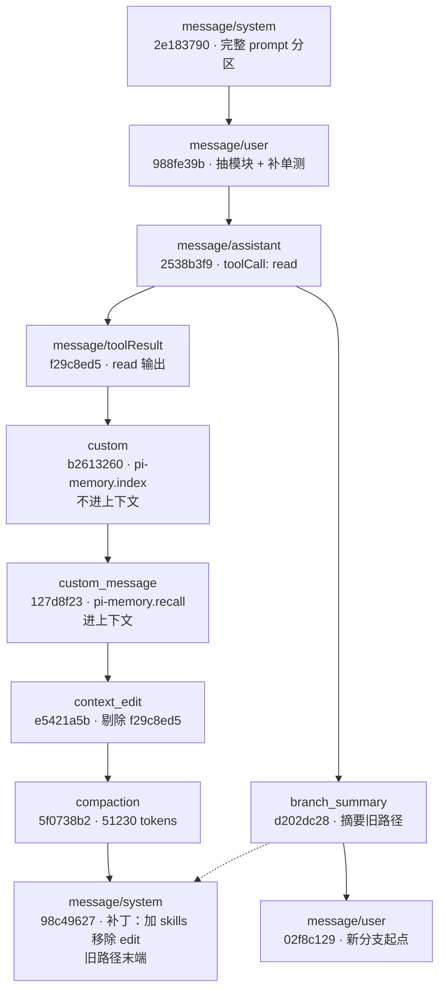

## 第 1 章 Pi 是什么

Pi 是 Earendil 公司开源的 agent harness，仓库 `earendil-works/pi`，MIT 协议，主要作者 Mario Zechner（GitHub 上的 badlogic，libGDX 的作者）。

时间线：2025 年 8 月建仓，9 月发 0.0.1，2026 年 10 月 1 日发 1.0，之后小步快跑，最新是 11 月 10 日的 1.5.2。十五个月，334 个 tag，7,786 次提交。

规模（2026-11-11 取数）：GitHub 12.1 万 star，1.56 万 fork，三百多位贡献者。npm 上 `@earendil-works/pi-coding-agent` 周下载 623 万，月下载 2,108 万。

生态：`pi.dev/packages` 收录 5,702 个包，分 extension / skill / prompt / theme 四类，全部由社区维护。头部是 billion-context（月下载 330 万，上下文压缩）、pi-mcp-adapter（160 万）、pi-web-access（130 万）、pi-subagents（89 万）。外部采用也有迹可循：OpenClaw（39.4 万 star）把 pi 当集成案例写进 README；Vercel AI SDK 里有 `@ai-sdk/harness-pi` 适配包，周下载 15 万。

定位一句话，README 第一句：

> Pi is a minimal, extensible agent harness that you can make your own.

### 1.1 两个原则

极简（minimalism）和可塑（malleability），这句自述里各占一半。

极简的边界 README 自己划了：

> Pi ships with powerful defaults but skips features like sub-agents and plan mode. **Ask Pi to build what you want**, or install a package that does it your way.

sub-agent、plan mode、权限系统，一个都不内置。缺什么，让 agent 自己写，或者装社区的包。

可塑是后半句。pi 提供四个扩展点：extensions（TypeScript 模块，能注册工具、命令、provider、事件、渲染器）、skills（按需加载的 markdown 说明书）、prompt templates、themes。打包成 Pi Package，走 npm 或 git 分发。

两条原则合起来，就是那 5,702 个包的来源：内置了，社区只能写配置；不内置，社区才有空间写实现。pi 今天的 star 和包数量，很大一部分来自它没做的事。

### 1.2 结构：十二个包

| 包 | 职责 | src 行数 |
|---|---|---|
| `pi-ai` | 多 provider 流式接口、重试、模型目录 | 2.9 万 |
| `pi-agent-core` | agent loop | 2,555 |
| `pi-coding-agent` | CLI、默认工具、session、扩展系统 | 7.9 万 |
| `pi-durable` | 可恢复的持久化运行时 | 3.6 万 |
| `chord` | 插件宿主（热重载、跨进程对象运行时） | 5.9 万 |
| `pi-tui` | 终端 UI 库（差分渲染） | 2.0 万 |
| `pi-mcp` | MCP 接入 | 4.7 千 |
| `pi-codemode` | "用代码调工具"的胶水层 | 3.0 千 |
| `pi-schema` | 事件与契约的 schema | 4.9 千 |
| `pi-env` | 运行环境抽象 | 2.6 千 |
| `pi-telemetry` | 与厂商无关的遥测契约 | 1.6 千 |
| `pi-evals` | 评测 | 1.4 千 |

第二行和第三行放在一起看：loop 本体 2,555 行，coding-agent 7.9 万行，差三十倍。差距全在 loop 之外——终端渲染、扩展协议、session 持久化、各家 provider 的差异。核心小到能整段读完，复杂度都堆在可替换的外围，这是极简最直接的结构性证据。

依赖是单向的：`pi-coding-agent` 依赖 `pi-agent-core`，反过来不成立；`pi-durable` 独立成包，任何 agent 都能装。loop 不知道 session 存在，session 不知道 CLI 存在。

信任边界也在这一层。`project_trust` 事件闸住项目级扩展和 skill 的加载：进一个新仓库，扩展不会自动跑起来。没有这道闸，"可塑"就直接等于"克隆一个仓库可能被执行任意代码"。


### 1.3 一个 959 行的 loop

极简最硬的证据是 loop 本体。`agent-loop.ts` 全文 959 行，真正的循环就是 `runLoop`，核心只有六十行左右。下面是保留控制流的版本：

```typescript
while (true) {                                  // 外循环：只为 follow-up 续跑
  let hasMoreToolCalls = true;
  while (hasMoreToolCalls || pendingMessages.length > 0) {   // 内循环：一次响应 + 一批工具
    if (lastCompletedTurn) {
      const snap = await config.prepareNextTurn?.(lastCompletedTurn);  // 压缩在这里发生
      if (pendingMessages.length === 0)
        pendingMessages = (await config.getSteeringMessages?.()) || [];  // 压缩期间打的字不丢
      await emit({ type: "turn_start" });
    }
    for (const m of declareToolChanges(currentContext, msgs)) {        // 工具增减补丁
      currentContext.messages.push(m);
    }
    await config.prepareRequest?.(ctx, signal);                        // 最后一次改写机会
    const message = await streamAssistantResponse(...);                // 流式响应
    if (message.stopReason === "error" || message.stopReason === "aborted") {
      await emit({ type: "agent_end", messages: newMessages });
      return;                                                          // 错误是硬出口
    }
    // 执行工具批 → hasMoreToolCalls 决定是否继续内循环
  }
  const followUps = (await config.getFollowUpMessages?.()) || [];
  if (followUps.length > 0) { pendingMessages = followUps; continue; }
  break;
}
```

三层嵌套各管一件事。

外循环只处理 follow-up：一轮跑完后用户又补了一句，直接续上，不重进整个流程。

内循环是"一次模型响应加一批工具调用"。工具返回后 `hasMoreToolCalls` 为真就再来一轮；模型说完了，退到外循环看有没有排队的新消息。

出口只有两个：错误或中断。`stopReason` 是 `error` 或 `aborted` 就直接 `return`，不重试、不修补状态，恢复责任甩给外层。pi-durable 就是那个外层，第 3 章讲它怎么接。

有个容易漏的细节：`getSteeringMessages()` 在 `prepareNextTurn` 之后才调。压缩可能耗时几秒，用户在这几秒里打的字在这里补收进来，不会丢。

上下文进模型前有两道变换，签名就是语义：

```typescript
transformContext?: (messages: AgentMessage[], signal?) => Promise<AgentMessage[]>;  // 可选：裁剪、注入
convertToLlm: (messages: AgentMessage[]) => Promise<Message[]>;                     // 必选：过滤、转写
```

`AgentMessage` 是开放的联合类型，应用可以塞自定义 role。session 存前者，模型看到后者。第 2 章的压缩就挂在这条缝上。


---

## 第 2 章 Session 树：一棵真实的树长什么样

pi 的会话是一个 JSONL 文件：一行一个条目，条目之间用 `id` / `parentId` 连成树。从当前叶子走到根的路径叫活跃分支，它才是下一次模型请求能看到的历史。

和"消息数组"的区别一句话说清：**数组只能追加，树可以分叉；数组压缩要改写，树压缩只是插一个条目。**

下面所有条目来自一段真实会话。我用 pi 的 `SessionManager` 把一次真实的开发过程录成 JSONL，格式与线上会话完全一致，可以直接 `pi --session` 打开。

### 2.1 十一种条目

`SessionEntry` 是个联合类型，一共十一种：

```typescript
export type SessionEntry =
  | SessionMessageEntry        // 对话消息
  | ThinkingLevelChangeEntry   // 思考档位切换
  | ModelChangeEntry           // 模型切换
  | UsageEntry                 // 单独的用量记账（如 cache_warm）
  | CompactionEntry            // 压缩摘要
  | BranchSummaryEntry         // 切分支时对旧路径的摘要
  | CustomEntry                // 扩展私有状态，不进模型上下文
  | CustomMessageEntry         // 扩展注入的消息，进模型上下文
  | ContextEditEntry           // 对早前条目的追加式改写
  | LabelEntry                 // 书签
  | SessionInfoEntry;          // 会话名
```

所有条目共享同一个基座：

```typescript
export interface SessionEntryBase {
  type: string;
  id: string;           // 8 位 hex，冲突时退化成完整 UUID
  parentId: string | null;
  timestamp: string;
}
```

文件第一行是 header，只有元信息，不在这棵树里：

```json
{"type":"session","version":3,"id":"01a1c96e-eb40-7364-88dd-a1a63ee463d9","timestamp":"2026-11-11T07:07:32.033Z","cwd":"/Users/ark/demo-shop"}
```

`version: 3` 是当前格式：v2 引入 `id`/`parentId` 变成树，v3 把 `hookMessage` 改名 `custom`。老会话加载时自动迁移。

### 2.2 一棵真实的树

这是那段会话跑完之后的完整结构。实线是 `parentId` 父子关系，虚线是 `branch_summary` 的 `fromId` 指针：



从 `assistant` 节点分出两条路：右边沿原路继续（扩展注入、编辑、压缩、工具补丁），先被放弃；左边挂着 `branch_summary` 开新分支。**两条路都在文件里，一字节没删。**

活跃分支是从 `02f8c129` 走到根的那条，投影出来就是 `system → user → assistant → branchSummary → user`。`toolResult`、`compaction`、`custom` 都不在模型眼前——它们在树上。

### 2.3 分支：一次 `branch()` 做了什么

"另开一条路"在文件里就是两行：先 `branchWithSummary()` 写摘要，然后正常 `appendMessage()`：

```json
{"type":"branch_summary","id":"d202dc28","parentId":"2538b3f9","timestamp":"2026-11-11T07:07:32.035Z","fromId":"98c49627","summary":"旧路径尝试直接改 checkout.ts：折扣逻辑原地抽成 3 个私有函数，2 个用例通过，剩 4 个未覆盖；工作区有改动，未提交。"}
{"type":"message","id":"02f8c129","parentId":"d202dc28","timestamp":"2026-11-11T07:07:32.035Z","message":{"role":"user","content":[{"type":"text","text":"换个做法：先在 pricing.ts 建模块，再让 checkout 调它"}],"timestamp":1794380852035}}
```

两个字段值得看：

- `parentId` 挂在上一个分支的 `assistant` 节点上——新路接在老路的中间，不是末尾
- `fromId` 指向被放弃分支的末端——摘要覆盖的是那个点往回的内容

`summary` 由模型生成，记的是"旧路做到了哪一步"，新分支的上下文里就有这条消息。切分支因此不丢信息。

顺带回答一个常见疑问：在 pi 里改一条旧消息为什么不用"撤销"？因为它压根不改，`appendMessage` 写新行而已。历史完整性是结构保证的，不靠代码纪律。

### 2.4 压缩：往树里插一个条目

上下文逼近窗口（`contextTokens > contextWindow - reserveTokens`，reserve 默认 16k）时触发压缩。压缩不删东西，只追加一个 `compaction` 条目：

```json
{"type":"compaction","id":"5f0738b2","parentId":"e5421a5b","timestamp":"2026-11-11T07:07:32.035Z",
 "summary":"## Goal\n把 checkout 的价格计算抽成独立模块并补单元测试。\n## Progress\n- Done: 读完 src/checkout.ts，确认 68 行折扣逻辑集中在 total()\n- In Progress: 设计 pricing 模块边界\n## Key Decisions\n- 金额统一用整数分，不用浮点\n## Next Steps\n1. 新建 src/pricing.ts\n2. 迁移 total() 与折扣分支\n3. 补 6 个边界用例",
 "firstKeptEntryId":"127d8f23",
 "tokensBefore":51230,
 "details":{"readFiles":["src/checkout.ts"],"modifiedFiles":[]}}
```

`firstKeptEntryId` 是压缩的全部机关：这个条目往后原样保留，往前用 `summary` 顶替。边界之前是摘要，边界之后是原文，两段拼起来就是模型看到的上下文。

注意切点落在哪：它指向那条 `custom_message`。选切点时会避开工具结果，`custom` 类消息是合法切点。

`summary` 用固定结构：Goal / Progress / Key Decisions / Next Steps。这个结构是给下一次压缩当输入的——下次压缩把旧摘要喂进去，保留既有信息、只更新进度。摘要越压越像一份长期笔记，而不是越压越模糊。

`systemMessage` 是压缩边界上的完整快照，由 pi 自动填入：

```json
"systemMessage": {
  "role": "system", "content": "",
  "sections": { "preamble": "You are pi, a coding agent.", "tools": "<tools>\n- read\n- edit\n- bash\n</tools>", "cwd": "/Users/ark/demo-shop" },
  "toolsAdded": [ {"name":"read",...}, {"name":"edit",...}, {"name":"bash",...} ]
}
```

它把边界之前的 `system` 补丁折叠成一份状态。重建上下文时，这份快照就是开头唯一的系统消息，边界内残留的 `system` 条目全部丢弃。

### 2.5 补丁式系统消息

会话开头的系统消息存完整的 prompt 分区加工具清单：

```json
{"type":"message","id":"2e183790","parentId":null,
 "message":{"role":"system","content":"",
   "sections":{"preamble":"You are pi, a coding agent.","tools":"<tools>\n- read\n- edit\n- bash\n</tools>","cwd":"/Users/ark/demo-shop"},
   "toolsAdded":[{"name":"read",...},{"name":"edit",...},{"name":"bash",...}]}}
```

后面的一切变化都走补丁，只写增量：

```json
{"type":"message","id":"98c49627","parentId":"5f0738b2",
 "message":{"role":"system","content":"",
   "sections":{"skills":"<skills>\n- pricing: 阶梯折扣与取整规则\n</skills>"},
   "toolsRemoved":[{"name":"edit","description":"Replace text in a file","parameters":{...}}]}}
```

`sections` 按名字打补丁，值为 `null` 表示删段；`toolsAdded` / `toolsRemoved` 是工具清单差分。整串补丁按顺序回放，就是当前的 prompt 和工具集——没有另存一份 prompt 状态。

这带来两个直接后果。

第一，状态和历史不可能不一致。不存在"prompt 状态说是 A、历史里写的是 B"这种 bug，因为 B 根本不落盘。

第二，关于 cache：文件里没有任何一条 `parentId` 被改过，前缀永远是前缀，一切变化都发生在尾巴上。changelog 里十几条修复是同一个主题：改工具、加 skill、切模型，都只动尾部。**前缀即资产**，在 pi 里这是和正确性同级的约束。


### 2.6 两种扩展条目：进不进上下文

```json
{"type":"custom","customType":"pi-memory.index","data":{"lastScanned":"f29c8ed5","memories":42},
 "id":"b2613260","parentId":"f29c8ed5","timestamp":"..."}
```

```json
{"type":"custom_message","customType":"pi-memory.recall",
 "content":"<memory-context>\n## project\n- 价格计算必须支持阶梯折扣（2026-10-28 确认）\n- 金额一律用整数分表示，禁止浮点\n</memory-context>",
 "display":false,
 "details":{"source":"knowledge/project/pricing.md","score":0.87},
 "id":"127d8f23","parentId":"b2613260","timestamp":"..."}
```

`custom` 是扩展的私有抽屉：存游标、索引、配置，模型看不见。`custom_message` 会变成消息进上下文，`display` 控制是否在 TUI 显示。一个扩展靠这两个条目就能在会话里自持状态：`custom` 记进度和游标，`custom_message` 往上下文注入信息，全程不用改内核。

### 2.7 上下文编辑：原地重开一条时间线

有一种需求树天然不支持：把早前某个工具结果从上下文里去掉，但不想分叉，也不想丢原文。0.87.0（2026-09-21）加了 `context_edit`：

```json
{"type":"context_edit","id":"e5421a5b","parentId":"127d8f23","timestamp":"...","targetId":"f29c8ed5","replacement":null}
```

`replacement: null` 表示把目标条目从上下文剔除。目标条目一个字没动：原文件里有，`/tree` 能看到，导出也还在，只是投影之后不再产生消息。实测：

```text
message/toolResult          → 0 msg     ← 被 context_edit 剔除
custom (pi-memory.index)    → 0 msg     ← 本来就不进上下文
custom_message (recall)     → 1 msg
context_edit                → 0 msg     ← 自己也不产生消息
```

几个细节：`replacement` 非 null 时可以换内容不换 role；同一目标被编辑多次，活跃分支上最后一条生效；编辑是分支相对的，回到编辑前的节点，原内容又回来了。

树还是那棵树，多了一层可见性图层：历史不变，投影可变。

### 2.8 树带来了什么

四条，都能在上面的 JSONL 里指出来：

- **分叉不要钱。** `branch()` 只挪指针，文件大小不变。
- **压缩不毁历史。** `compaction` 是条目不是替换，想回到压缩前的上下文，沿着树走过去就行。
- **状态没有第二份。** prompt 和工具集都是补丁序列，回放即状态，少一份状态就少一类不一致。
- **扩展有地方住。** `custom` / `custom_message` / `context_edit` 三个口子，状态记录、注入、修剪全能落地，不用改内核。

第 3 章讲这套树在崩溃后怎么恢复。


---

## 第 3 章 pi-durable：让 loop 在崩溃后接着跑

`pi-durable` 是 2026 年 10 月 1 日随 1.0.0 发布的实验包，官方定义只有一句：

> A durable agent harness.

README 第一行还压着更实在的一句：Experimental，API 随时可能变。生产使用要掂量，但它解决的问题是真的。

### 3.1 普通 loop 为什么怕崩溃

agent loop 拆到最小是四步循环：

```text
调模型 → 拿回答 → 调工具 → 再调模型 → ……
```

`pi-agent-core` 那个 959 行的文件就是这个形状。干活的状态全在内存里：`messages` 数组、当前的 assistant 消息、流式进来的 token、还没返回的工具调用。

进程没了，这些就没了。像打游戏一直不存档：跑五分钟崩了损失五分钟，跑五小时崩了损失五小时，而 agent 恰恰越跑越贵。

比重来更麻烦的是副作用。文件改了一半、邮件发出去、PR 开出来，记录却随内存一起消失。重启后 agent 不知道这些事发生过，可能再改一遍、再发一封。

pi-durable 给这个循环补上存档。

### 3.2 一条规矩：先存盘，再显示

它的规矩只有一条，README 写在第二句：

> Conversations, model turns, tool calls, and your own state are committed to storage before anything is shown.

用户输入、模型回答、工具调用和结果、扩展自己的状态，全部先写进存储，写成功才算发生过。屏幕、TUI、watch 回调都排在写之后。

一次问答在存储里长这样（README 原样）：

```text
submit(input) → pi.user
  pi.generation → pi.system (only if the prompt or tools changed), pi.assistant (tool calls)
    pi.tool × n → pi.tool-result × n   (owned by the generation, which waits for them)
  pi.generation → pi.assistant (answer) → submission done
```

人话版四步：你的输入、模型回答加工具调用、工具结果、最终答案。每一步独立提交，有自己的序号。

原子性由存储层给，各后端承诺的强度不同：

- **SQLite**：整批写进一个事务，要么全进要么全不进。WAL + `synchronous = NORMAL`，进程崩溃不丢，断电或宿主机故障可能丢最新一笔。
- **JSONL**：先追加 sidecar 记录并 `fsync`，再追加提交标记到 `main.jsonl`。标记没落地的那批等于不存在，重启时被当撕裂行截掉。`fsync` 要显式开 `{ fsync: true }`。
- **IndexedDB**：浏览器端一次事务；多标签页要用 Web Lock 保证只有一个 owner。
- **Cloudflare DO**：提交就是 Durable Object 自己的存储事务。

存储还提供一个 `receive(index, seq)` 持久化回执：这批确实落盘了，Session 才把序号交给内存。内存指针在存储返回之后才切换（`Transaction.adopt(seq)`）。所以屏幕永远比存储慢半步，"看到过但没存下来"这个状态不存在。

实测一次最小问答（pi-durable 1.5.2 + SQLite + faux provider + 一个 `replay: "safe"` 的 `read_file`），存储里的条目链和任务树：

```text
entries
  pi.user           byTask -     model [user]
  pi.system         byTask 9     model [system]
  pi.assistant      byTask 9     model [assistant]
  pi.tool-result    byTask 12    model [toolResult(read_file)]
  pi.assistant      byTask 14    model [assistant]

tasks
  #9   pi.generation   terminal
  #12  pi.tool         terminal   owner 9
  #14  pi.generation   terminal
```

两个 generation 任务中间夹一个 tool 任务，工具任务的 owner 指向前一个 generation——工具是 generation 的子任务，generation 等它。工具崩了归谁管，答案就在这：归调用它的那个 generation。


### 3.3 崩了之后，三种死法

死在哪，决定怎么赔。

#### 死在模型调用

算一次失败尝试。`settings.retry` 默认 `{ maxRetries: 3, baseDelayMs: 2000, maxAgentDelayMs: 60000 }`，退避 2 秒、4 秒、8 秒，封顶一分钟。

已经流出来的半截回答不会扔：转成一条 `stopReason: "aborted"` 的 assistant 条目落盘，下一次尝试重新发请求。

实测：用 Proxy 把存储弄成"断电"，在第 28 个字掐死进程，重开 `resume()`：

```text
pi.user        chars 6    "重构这个模块"
pi.assistant   stop "aborted"  chars 28   "先检查目录结构，然后逐个读文件……"   ← 死前的半截
pi.assistant   stop "stop"     chars 9    "重试后的完整回答。"                ← 重试的结果
submission: done
```

关键在 context.ts 这一行：

```typescript
const EXCLUDED_STOP_REASONS: ReadonlySet<AssistantMessage["stopReason"]> =
  new Set(["aborted", "error", "deferred"]);
```

`aborted` 在排除表里。半截回答留在存储里供审计，但不会进模型上下文。重试拿到干净的历史，模型看不到自己断掉的半句话，也就不会接着往下编。

重试用完，run 以 `interrupted` 结束，submission 落到 `unanswered`。如果模型是正常返回了一个错误响应，走的则是 `model_error` 那条路。

另外 `close()` 不算 crash：关进程时停掉的请求，下次打开直接重发，不记失败次数。

#### 死在工具执行半路

最麻烦的一种。工具没有"流式"的概念，要么跑完要么没跑完，"没跑完"意味着外部世界可能被改了一半。单独放 3.4 讲。

#### 用户重复提交

最隐蔽的一种，因为它不发生在进程里，发生在人手上：界面转圈，用户以为卡了，又点一次发送。

`submit()` 可以带一个 `requestId`：

```typescript
const sub = await root.submit(
  { type: "input", content: "Hello", requestId: "greeting-1" },
  context,
);
```

这个 id 由调用方生成，pi 不生成。它是个去重键，作用域是单个 conversation，类型注释写得很直白：`Host-provided deduplication key, scoped to the conversation`。

存储层建了索引：

```sql
request_id TEXT,
CREATE INDEX ... ON submissions (conversation_id, request_id)
```

每次提交进来，`admitSubmission()` 先查这个索引：

```typescript
if (draft.requestId !== undefined) {
  const existing = await tx.submissionByRequest(conversationId, draft.requestId);
  if (existing !== undefined) {
    if (existing.type !== draft.type) {
      throw new Error(`Request ${draft.requestId} already identifies a submission of type ${existing.type}`);
    }
    return { id: existing.id, status: existing.status };
  }
}
```

命中就直接返回既有 submission，一条新记录不写。第二次点击的效果是"拿回上次那个 id"，不是"再开一次跑"；拿着 id 调 `wait()`，等到的还是原来那次。同一个 id 换个 type 复用会直接抛错。

不带 `requestId` 的提交每次都算新的。实测三种情况：

```text
同 requestId 提交两次     → submission id 8，两次都 8，sameSubmission: true
换一个 requestId          → submission id 12，独立 run
不带 requestId 提交两次   → 两条 pi.user + 两条 pi.assistant，两个独立 run
```

重启之后索引依然有效——它在存储里，不在内存里。所以"存储报错 → 重开 → 重提交同一个 requestId"这条恢复路径才成立。

边界也要说清：requestId 保证同一次提交只被接纳一次，不保证工具幂等。工具那一层是下一节的事。

### 3.4 工具崩在半路，该不该自动重跑

这是个价值观问题，pi 把它变成了声明问题。

工具分两堆：查询、读文件、跑测试，重跑没有副作用；发邮件、转账、开 PR，重跑就是事故。框架猜不出来，所以让工具自己声明：

```typescript
export type ToolRegistration<TParameters extends object = object, ...> = Tool<TParameters> & {
  /** Whether an interrupted execution may rerun on recovery. Default `unsafe`. */
  readonly replay?: "safe" | "unsafe";
  // ...
};
```

默认 `unsafe`。工具真正执行之前，先把意图落盘，意图里带最终参数和这个策略：

```typescript
await commitIntent(runtime, {
  phase: "execute",
  arguments: final,
  replay: tool.replay ?? "unsafe",
}, context);
```

意图落盘之后才执行。这个顺序很关键：崩在 `commitIntent` 之前，工具根本没跑过；崩在之后，存储里有一条"我打算这么跑"的记录。

恢复时走 `execute` 阶段，判定是双 safe：

```typescript
if (replay === "safe" && tool?.replay === "safe") {
  // 清掉上次发布的进度，从头重跑
  return run(runtime, task.input, call, tool, args, { wake, checkpoint }, context);
}
```

`replay` 是落盘时的策略，`tool?.replay` 是现在这份代码里的策略。两个都 safe 才重跑——中途改过代码、把 safe 改成 unsafe，落盘时的承诺就不算数了。

不重跑的那条路，往上下文里写一条错误结果：

```text
<harness>
[error] Tool send_email was interrupted and may have partially run
</harness>
```

措辞很讲究："可能跑了一半"，没说成功也没说失败，因为确实不知道。模型读到这句自己去查：查发件箱、查订单状态，或者停下来问人。判断权交给最了解上下文的一方，内核不下结论。

同一个崩溃场景的三组实测：

```text
A. replay: "safe"
   totalToolInvocations 2   submission done
   toolResult: "sent to a@b.c"   diagnostics []

B. 默认（unsafe）
   totalToolInvocations 1   submission done
   toolResult: "<harness> [error] Tool send_email was interrupted
                and may have partially run </harness>"
   diagnostics: [{ code: "interrupted" }]
```

A 和 B 的差别，就是工具定义里那一个字段。


### 3.5 兜底：连续崩 5 次就停

如果崩溃是确定性的呢？某个任务一跑就把进程撑爆，重启、恢复、再撑爆，永远转下去。所以有计数器：

```typescript
export const DEFAULT_RESTART_LIMIT = 5;
```

计数发生在打开存储的那一刻：恢复时扫到 `status === "running"` 的任务，说明它被上次的进程带走了，`restarts` 加一并退回 pending。

清零的时机是关键：任务提交出一个新状态，`restarts` 就消失。所以它是"连续被中断次数"，不是"总次数"。只要每次崩溃之间确实往前走了一步，计数一直归零；只有原地踏步的死循环才撞上限。

撞上之后：

```typescript
const message = `Tool ${call.name} was interrupted ${cutOffCount(task)}; it is not run again`;
const ending = { status: "failed", message, reason: "restart_limit" } as const;
```

`cutOffCount` 渲染成人话：`once` 或 `N times in a row`。实测（把 restartLimit 调到 3）：

```text
C. replay: "safe"，每次都在工具里崩，restartLimit 3
   totalToolInvocations 3
   toolResult: "<harness> [error] Tool send_email was interrupted
                3 times in a row; it is not run again </harness>"
   diagnostics: [{ code: "restart_limit" }]
```

调用了三次，然后停。同一套逻辑对 generation、compaction、自定义任务都成立，失败表现不同：工具拿到一条错误结果，compaction 落进 `compactionFailure`，run 的失败原因是 `restart_limit`。共同点是都走 `onReport`，宿主不会在黑暗里被反复重启。

还有一条容易忽略的规则：进程死的时候，所有在跑的任务都计数，不只是弄死进程的那个——对它们来说这一轮同样白跑。


### 3.6 一个进程写，别人只能看

前面所有保证都压在一个前提上，README 写得很硬：

> One process writes a storage at a time; there is no cross-process locking.

一份存储同一时刻只有一个写者，pi 不做跨进程加锁。这不是没做完，是划边界：它没有承诺"多进程共享一份数据库还能保证原子提交"。做那件事需要分布式租约、选主、提交仲裁，是另一个量级的复杂度。pi 把它交给宿主——要高可用，自己保证同一时刻只有一个写者。

第二个进程想看同一份会话，开 `readOnly: true`：

```typescript
const harness = await Harness.open(storage, { models, registry, readOnly: true }, context);
```

只读打开什么都不恢复：不计数、不重跑、不发布。任何带写的 commit、`resume()`，都在到达存储之前被拒：

```typescript
if (this.#readOnly) {
  // Refused before Storage: the Session stays healthy, and the caller sees why.
  tx.discard();
  this.#sweepDocuments();
  throw new ReadOnlySession("a commit with writes");
}
```

"在存储之前拒掉"很重要：不打脏任何东西，Session 不会进入失败态，这次调用只是被告知"我是读者"。

四种存储的读者约束不一样，坑也各不一样：

- **JSONL**：最反直觉，可写打开本身就在写盘——截掉撕裂尾行、清掉没提交标记的 sidecar、回收废弃记录。第二个进程若以可写方式打开一个正在被写的目录，会顺手"修"写者正在追加的文件，这就是数据损坏。所以 JSONL 的打开必须自己也带 `readOnly: true`；只读打开一个字节不写，撞上写者的提交就重试。
- **SQLite**：文件锁是 SQLite 自己的，读者照常打开即可。
- **IndexedDB**：没有跨标签页锁，得用 Web Lock 围住生命周期。
- **Cloudflare DO**：天生单线程，单写者是免费的。

单写者换来一个实在的好处：提交序号不需要协调。写者一个个拿 seq，全序是天然的，发布顺序等于存储顺序，不需要共识算法。"先存盘再显示"能做得这么便宜，根子在这。

故障切换也顺理成章：旧写者死了，新进程以可写方式打开同一份存储，`resume()`，从最后一个完整提交接着跑。谁是当前写者，存储层不管，宿主定。

### 3.7 内核给了什么

四条：写成功才算发生；三类崩溃分开处理；默认值站在安全那边（replay 默认 unsafe，restartLimit 默认 5）；边界划在进程上，一个写者加任意读者。

pi 的三层到这里讲完：loop 负责跑，session 树负责记，pi-durable 负责崩了之后还能接着跑。
