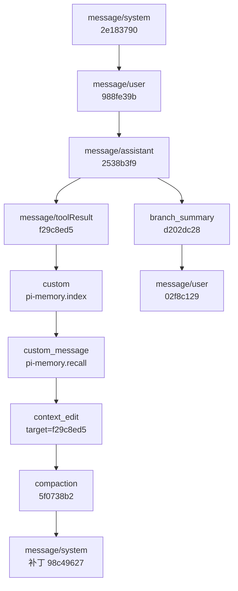
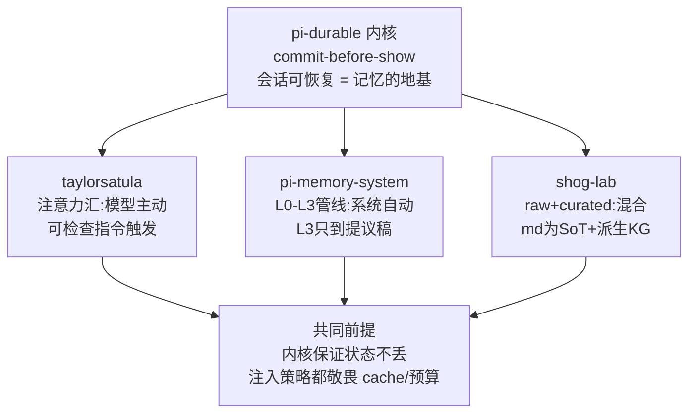
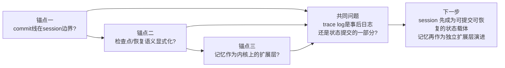

## 第 1 章 Pi 是什么

Pi 是 Earendil Inc. 开源的 agent harness，仓库 `earendil-works/pi`，MIT 协议。主要作者 Mario Zechner，GitHub 上的 badlogic，libGDX 的作者。

时间线：2025 年 8 月 9 日建仓，9 月发出 0.0.1，2026 年 10 月 1 日发 1.0，之后 1.1 到 1.5 小步快跑，最新是 11 月 10 日的 1.5.2。十五个月，334 个 tag，7,786 次提交。

规模（数据取自 2026 年 11 月 11 日）：GitHub 12.1 万 star，1.56 万 fork，340 watch，贡献者三百多位。npm 上 `@earendil-works/pi-coding-agent` 周下载 623 万，月下载 2,108 万。它在这几个数字上已经不是小众工具了。

生态：`pi.dev/packages` 收录 5,702 个包，分 extension / skill / prompt / theme 四类。按下载量排头部是 billion-context（月下载 330 万，上下文压缩）、pi-mcp-adapter（160 万）、pi-web-access（130 万）、pi-subagents（89 万）。这些都不是官方维护的。

外部采用：OpenClaw（39.4 万 star）把 pi 当作真实集成案例写进 README；Vercel 的 AI SDK 仓库里有 `@ai-sdk/harness-pi` 适配包，周下载 15 万。

README 第一句就把定位说清了：

> Pi is a minimal, extensible agent harness that you can make your own.

### 1.1 两个原则

极简（minimalism）和可塑（malleability）。这句话本身藏着全部设计意图，"minimal" 和 "make your own" 各占一半。

极简的边界 README 自己划：

> Pi ships with powerful defaults but skips features like sub-agents and plan mode. **Ask Pi to build what you want**, or install a package that does it your way.

sub-agent、plan mode、记忆、权限系统，一个都不内置。缺什么就让 agent 自己写，或者装社区的包。

可塑是后半句。pi 给了四个扩展点：extensions（TypeScript 模块，能注册工具、命令、provider、事件、渲染器）、skills（按需加载的 markdown 说明书）、prompt templates、themes。打包成 Pi Package，走 npm 或 git 分发。

两条合起来，就是那 5,702 个包的来源。内置了，社区只能写配置；不内置，社区才有空间写实现。反过来说也成立：pi 今天的 star 数和包的数量，很大一部分来自它没做的东西。

### 1.2 结构：十二个包

| 包 | 职责 | src 行数 |
|---|---|---|
| `pi-ai` | 多 provider 流式接口、重试、模型目录 | 2.9 万 |
| `pi-agent-core` | agent loop | 2,555 |
| `pi-coding-agent` | CLI、默认工具、session、扩展系统 | 7.9 万 |
| `pi-durable` | 可恢复的持久化运行时 | 3.6 万 |
| `chord` | 插件宿主（热重载、跨进程对象运行时） | 5.9 万 |
| `pi-tui` | 终端 UI 库（差分渲染） | 2.0 万 |
| `pi-mcp` | MCP 接入 | 4.7 千 |
| `pi-codemode` | "用代码调工具"的胶水层 | 3.0 千 |
| `pi-schema` | 事件与契约的 schema | 4.9 千 |
| `pi-env` | 运行环境抽象 | 2.6 千 |
| `pi-telemetry` | 与厂商无关的遥测契约 | 1.6 千 |
| `pi-evals` | 评测 | 1.4 千 |

看第二行和第三行：loop 本体 2,555 行，coding-agent 7.9 万行，差三十倍。差距全在 loop 之外——终端渲染、扩展协议、session 持久化、各家 provider 的差异、四种运行模式。这就是极简的结构性证据：核心小到可以整段读完，复杂度全堆在可替换的外围。

依赖是单向的。`pi-coding-agent` 依赖 `pi-agent-core`，反过来不成立；`pi-durable` 独立成包，任何 agent 都能装。loop 不知道 session 存在，session 不知道 CLI 存在。

信任边界也在这一层。`project_trust` 事件闸住项目级扩展和 skill 的加载：进一个新仓库，扩展不会自动跑起来。没有这道闸，可塑直接等于"克隆一个仓库可能被执行任意代码"。


### 1.3 六十行 loop

极简最硬的证据是 loop 本体。`agent-loop.ts` 全文 959 行，真正的循环就是一个 `runLoop`。下面是保留控制流的版本：

```typescript
while (true) {                                  // 外循环：只为 follow-up 续跑
  let hasMoreToolCalls = true;
  while (hasMoreToolCalls || pendingMessages.length > 0) {   // 内循环：一次响应 + 一批工具
    if (lastCompletedTurn) {
      const snap = await config.prepareNextTurn?.(lastCompletedTurn);  // 压缩在这里发生
      if (pendingMessages.length === 0)
        pendingMessages = (await config.getSteeringMessages?.()) || [];  // 压缩期间打的字不丢
      await emit({ type: "turn_start" });
    }
    for (const m of declareToolChanges(currentContext, msgs)) {        // 工具增减补丁
      currentContext.messages.push(m);
    }
    await config.prepareRequest?.(ctx, signal);                        // 最后一次改写机会
    const message = await streamAssistantResponse(...);                // 流式响应
    if (message.stopReason === "error" || message.stopReason === "aborted") {
      await emit({ type: "agent_end", messages: newMessages });
      return;                                                          // 错误是硬出口
    }
    // 执行工具批 → hasMoreToolCalls 决定是否继续内循环
  }
  const followUps = (await config.getFollowUpMessages?.()) || [];
  if (followUps.length > 0) { pendingMessages = followUps; continue; }
  break;
}
```

三层嵌套各管一件事。

外循环只处理 follow-up。用户在一轮跑完之后又补一句话，不用重进整个流程，直接续上。

内循环是"一次模型响应加一批工具调用"。工具返回后 `hasMoreToolCalls` 为真就再进一轮；模型说完了，退到外循环看有没有排队的新消息。

出口只有两个：错误或者中断。`stopReason` 是 `error` 或 `aborted` 时直接 `return`，不重试，不修补状态。恢复责任被明确甩给外层——`pi-durable` 就是那个外层，第 3 章讲它怎么接。

还有个容易漏的细节：`getSteeringMessages()` 在 `prepareNextTurn` 之后才调。压缩可能耗时几秒，用户在这几秒里打的字，被这里补收进来，不会丢。

上下文进模型前有两道变换，签名就是语义：

```typescript
transformContext?: (messages: AgentMessage[], signal?) => Promise<AgentMessage[]>;  // 可选：裁剪、注入
convertToLlm: (messages: AgentMessage[]) => Promise<Message[]>;                     // 必选：过滤、转写
```

`AgentMessage` 是开放的联合类型，应用可以塞自定义 role。session 存的是前者，模型看到的是后者。树上的语义和发给 LLM 的语义在这里分开，第 2 章的压缩、第 4 章的记忆注入，都挂在这条缝上。


---

## 第 2 章 Session 树：一棵真实的树长什么样

pi 的会话是一个 JSONL 文件，一行一个条目，条目之间用 `id` / `parentId` 连成树。当前叶子到根的路径叫活跃分支，那才是下一次模型请求的历史。

一句话说清它跟"消息数组"的区别：**数组只能追加，树可以分叉；数组压缩要改写，树压缩只是插一个条目。**

下面所有条目都来自一段真实会话。我用 pi 的 `SessionManager` 写了个脚本，把一次真实的开发过程录成 JSONL（脚本在 `SessionManager` 的公开 API 上跑，条目格式与线上会话完全一致，可以直接 `pi --session` 打开）。

### 2.1 十一种条目

`SessionEntry` 是个联合类型，一共十一种：

```typescript
export type SessionEntry =
  | SessionMessageEntry        // 对话消息
  | ThinkingLevelChangeEntry   // 思考档位切换
  | ModelChangeEntry           // 模型切换
  | UsageEntry                 // 单独的用量记账（如 cache_warm）
  | CompactionEntry            // 压缩摘要
  | BranchSummaryEntry         // 切分支时对旧路径的摘要
  | CustomEntry                // 扩展私有状态，不进模型上下文
  | CustomMessageEntry         // 扩展注入的消息，进模型上下文
  | ContextEditEntry           // 对早前条目的追加式改写
  | LabelEntry                 // 书签
  | SessionInfoEntry;          // 会话名
```

所有条目共享同一个基座：

```typescript
export interface SessionEntryBase {
  type: string;
  id: string;           // 8 位 hex，冲突时退化成完整 UUID
  parentId: string | null;
  timestamp: string;
}
```

文件第一行是 header，只有元信息，不在这棵树里：

```json
{"type":"session","version":3,"id":"01a1c96e-eb40-7364-88dd-a1a63ee463d9","timestamp":"2026-11-11T07:07:32.033Z","cwd":"/Users/ark/demo-shop"}
```

`version: 3` 是当前格式。v2 引入 `id`/`parentId` 变成树，v3 把 `hookMessage` 改名成 `custom`。老会话加载时自动迁移。

### 2.2 一棵真实的树

这是那段会话跑完之后的完整结构。每行一个条目，缩进表示父子关系：

```text
message/system  [2e183790]  完整 prompt 分区 + 三个工具声明
└─ message/user [988fe39b]  "把 checkout 的价格计算抽成独立模块，再补一组单测"
   └─ message/assistant [2538b3f9]  文本 + toolCall(read, src/checkout.ts)
      └─ message/toolResult [f29c8ed5]  read 的输出
         └─ custom [b2613260]  pi-memory.index  ← 扩展私有状态，不进上下文
            └─ custom_message [127d8f23]  pi-memory.recall  ← 记忆注入，进上下文
               └─ context_edit [e5421a5b]  targetId=f29c8ed5, replacement=null
                  └─ compaction [5f0738b2]  firstKeptEntryId=127d8f23, 51230 tokens
                     └─ message/system [98c49627]  补丁：加 skills 段，移除 edit 工具
      └─ branch_summary [d202dc28]  fromId=98c49627，旧路径摘要
         └─ message/user [02f8c129]  "换个做法：先在 pricing.ts 建模块"
```

从 `assistant` 那个节点分出了两条路：往右是原路一直跑下去（记忆、编辑、压缩、工具补丁），先被放弃；往左挂着 `branch_summary`，然后开新分支继续。**两条路都在文件里，一字节没删。**

对应的 mermaid：



把这份文件读进 `SessionManager` 之后 `getTree()` 输出完全一样，`buildSessionContext()` 只取活跃分支那一列（`system → user → assistant → branchSummary → user`），`toolResult`、`compaction`、`custom` 全部不在里面——它们在树上，不在模型眼前。

### 2.3 分支：一次 `branch()` 做了什么

"另开一条路"在文件里就是三行。先 `branch(a1)` 把叶子指针挪回助手那条消息，再 `branchWithSummary()` 写摘要，然后正常 `appendMessage()`：

```json
{"type":"branch_summary","id":"d202dc28","parentId":"2538b3f9","timestamp":"2026-11-11T07:07:32.035Z","fromId":"98c49627","summary":"旧路径尝试直接改 checkout.ts：折扣逻辑原地抽成 3 个私有函数，2 个用例通过，剩 4 个未覆盖；工作区有改动，未提交。"}
{"type":"message","id":"02f8c129","parentId":"d202dc28","timestamp":"2026-11-11T07:07:32.035Z","message":{"role":"user","content":[{"type":"text","text":"换个做法：先在 pricing.ts 建模块，再让 checkout 调它"}],"timestamp":1794380852035}}
```

两个字段值得看：

- `parentId` 指向上一个分支的 `assistant` 节点 — 新路挂在老路的中间，不是挂在末尾
- `fromId` 指向被放弃分支的末端 `98c49627` — 摘要覆盖的是那个点往回的内容

`summary` 是模型生成的，里面记的是"放弃的那条路做到了哪一步"。所以切分支不丢信息：新分支的上下文里有一条 `branchSummary` 消息，开头就是那段话。

这也解释了一个常见疑问：为什么 pi 里改一条旧消息不用"撤销"。它压根不改，`appendMessage` 而已，历史完整性是结构保证的，不是靠代码纪律。

### 2.4 压缩：往树里插一个条目

上下文逼近窗口时（`contextTokens > contextWindow - reserveTokens`，reserve 默认 16k）触发压缩。压缩不删东西，只追加一个 `compaction` 条目：

```json
{"type":"compaction","id":"5f0738b2","parentId":"e5421a5b","timestamp":"2026-11-11T07:07:32.035Z",
 "summary":"## Goal\n把 checkout 的价格计算抽成独立模块并补单元测试。\n## Progress\n- Done: 读完 src/checkout.ts，确认 68 行折扣逻辑集中在 total()\n- In Progress: 设计 pricing 模块边界\n## Key Decisions\n- 金额统一用整数分，不用浮点\n## Next Steps\n1. 新建 src/pricing.ts\n2. 迁移 total() 与折扣分支\n3. 补 6 个边界用例",
 "firstKeptEntryId":"127d8f23",
 "tokensBefore":51230,
 "details":{"readFiles":["src/checkout.ts"],"modifiedFiles":[]}}
```

`firstKeptEntryId` 是压缩的全部魔法。它说：从这个条目往后的内容原样保留，往前的用 `summary` 顶替。

注意 `firstKeptEntryId` 指向 `127d8f23`，正是那条 `custom_message`。压缩边界落在记忆注入上，记忆没被压掉。这不是巧合：选切点时会避开工具结果，而 `custom` 类消息是合法切点。

`firstKeptEntryId` 起名很准：它不是指针，是**边界**。边界之前是摘要，边界之后是原文，两段拼起来才是模型看到的上下文。

`summary` 用固定结构：Goal / Progress（Done / In Progress / Blocked）/ Key Decisions / Next Steps / Critical Context。这结构是给下一次压缩当输入的——下次压缩把这份摘要喂进去，要求保留全部既有信息、只更新进度。摘要是迭代的，越压越像长期记忆，而不是越压越模糊。

`systemMessage` 是压缩边界上的一份完整快照，这次由 pi 自动填了进去：

```json
"systemMessage": {
  "role": "system", "content": "",
  "sections": { "preamble": "You are pi, a coding agent.", "tools": "<tools>\n- read\n- edit\n- bash\n</tools>", "cwd": "/Users/ark/demo-shop" },
  "toolsAdded": [ {"name":"read",...}, {"name":"edit",...}, {"name":"bash",...} ]
}
```

它把边界之前那一串 `system` 补丁全部折叠成一份状态。压缩之后重建上下文时，这份快照变成开头唯一的系统消息，边界内残留的 `system` 条目全部丢弃——不然后一步会带着一堆已经不成立的补丁。

### 2.5 补丁式系统消息

会话开头的系统消息存的是完整的 prompt 分区加工具清单：

```json
{"type":"message","id":"2e183790","parentId":null,
 "message":{"role":"system","content":"",
   "sections":{"preamble":"You are pi, a coding agent.","tools":"<tools>\n- read\n- edit\n- bash\n</tools>","cwd":"/Users/ark/demo-shop"},
   "toolsAdded":[{"name":"read",...},{"name":"edit",...},{"name":"bash",...}]}}
```

后面的一切变化都走补丁，追加一条新的 `system` 消息，只写增量：

```json
{"type":"message","id":"98c49627","parentId":"5f0738b2",
 "message":{"role":"system","content":"",
   "sections":{"skills":"<skills>\n- pricing: 阶梯折扣与取整规则\n</skills>"},
   "toolsRemoved":[{"name":"edit","description":"Replace text in a file","parameters":{...}}]}}
```

`sections` 按名字打补丁，值为 `null` 表示删掉这一段；`toolsAdded` / `toolsRemoved` 是工具清单的差分。把这一串补丁按顺序回放，得到的就是当前的 prompt 和工具集——**没有另存一份 prompt 状态**。

这个设计有一个直接后果：状态和历史不可能不一致。不存在"prompt 状态说是 A，历史里写的是 B"这种 bug，因为 B 根本不存在。

另一个后果关于 cache。整个文件里没有一条 `parentId` 被改过，前缀永远是前缀。改工具、加 skill、换模型，全都发生在尾巴上。这套纪律在 changelog 里能数出十几条修复，全是一个主题：Anthropic 同名工具重定义改成对话内联、摘要请求不带 thinking 块、切模型丢掉旧模型的 thinking、resume 时恢复工具集。**前缀即资产**，这条在 pi 里是和正确性同级的约束。


### 2.6 两种扩展条目：进不进上下文

第 4 章的记忆插件全建在这两个条目类型上，先把它们分清楚：

```json
{"type":"custom","customType":"pi-memory.index","data":{"lastScanned":"f29c8ed5","memories":42},
 "id":"b2613260","parentId":"f29c8ed5","timestamp":"..."}
```

```json
{"type":"custom_message","customType":"pi-memory.recall",
 "content":"<memory-context>\n## project\n- 价格计算必须支持阶梯折扣（2026-10-28 确认）\n- 金额一律用整数分表示，禁止浮点\n</memory-context>",
 "display":false,
 "details":{"source":"knowledge/project/pricing.md","score":0.87},
 "id":"127d8f23","parentId":"b2613260","timestamp":"..."}
```

`custom` 是扩展的私有抽屉：存游标、存索引、存配置，模型永远看不见。`custom_message` 会变成一条消息进上下文，`display` 控制要不要在 TUI 里显示（`false` 就是纯后台注入）。`details` 给扩展自己用，不发给模型。

一个插件靠这两个就能独立完成全部记忆功能：用 `custom` 记"我看到哪了"，用 `custom_message` 往上下文里塞"我想让模型想起什么"。后面的章节会看到，三家插件都是这个套路的不同变体。

### 2.7 上下文编辑：原地重开一条时间线

有一种需求树结构天然不支持：**想把早前某个工具结果从上下文里去掉，但不想分叉，也不想丢原文。**

0.87.0（2026-09-21）加了 `context_edit`：

```json
{"type":"context_edit","id":"e5421a5b","parentId":"127d8f23","timestamp":"...","targetId":"f29c8ed5","replacement":null}
```

`replacement: null` 表示把目标条目从模型上下文里剔除。目标条目本身一个字都没动——原文件里有，`/tree` 里能看到，导出也还在，只是 `buildSessionProjection()` 之后它不产生消息了。刚才的实测输出：

```text
message/toolResult          → 0 msg     ← 被 context_edit 剔除
custom (pi-memory.index)    → 0 msg     ← 本来就不进上下文
custom_message (recall)     → 1 msg
context_edit                → 0 msg     ← 自己也不产生消息
```

几个细节：`replacement` 非 null 时可以替换内容而不换 role 和元数据；同一个目标被编辑多次，活跃分支上最后一条生效；编辑是分支相对的——回到编辑之前的节点，原内容又回来了。

这个机制实际上把"树"升级成了"树 + 可见性图层"。历史不变，投影可变。

### 2.8 所以树带来了什么

四条，都能在上面的 JSONL 里指出来：

**分叉不要钱。** `branch()` 只挪指针，`appendMessage()` 只是写新行。一次 `/tree` 回退，文件大小不变。

**压缩不毁历史。** `compaction` 是条目不是替换，`firstKeptEntryId` 划一条边界。想回到压缩前的完整上下文，走过去就行。

**状态没有第二份。** prompt 和工具清单都是补丁序列，回放即状态。少一份状态，就少一类不一致。

**扩展有地方住。** `custom` / `custom_message` / `context_edit` 三个口子，记忆、检索、注入、修剪全能落在这套模型里，不用改内核。

第 3 章讲这套树怎么在崩溃后恢复，第 4 章讲记忆插件怎么长在它上面。


---

## 第 3 章 pi-durable：让 loop 在崩溃后接着跑

`pi-durable` 是 2026 年 10 月 1 日随 1.0.0 发出来的实验包，官方给它的定义只有一句：

> A durable agent harness.

README 第一行还压着一句更重要的：**Experimental. The API changes without notice between releases.** 这包在生产里用之前得掂量，但它解决的问题是真问题。

### 3.1 普通 loop 为什么怕崩溃

把 agent loop 拆到最小，它是四步循环：

```text
调模型 ──→ 拿回答 ──→ 调工具 ──→ 再调模型 ──→ ……
```

`pi-agent-core` 那段 959 行的循环就是这个形状。真正干活的东西全在内存里：`messages` 数组、当前这一轮的 assistant 消息、正在流式进来的 token、还没返回的工具调用、工具的中间输出。

状态只在内存，意味着进程没了它们就没了。像打游戏一直不存档，突然停电，进度回到上一个存档点——问题是 agent 世界压根没有存档点。

而且风险随运行时长线性上涨。一次真实的编码任务，几十轮交互、上百次工具调用、持续几小时，中间任何一次 OOM、容器回收、网络断开、笔记本合盖，都可能让整个 loop 从第一步重来。

比"重来"更麻烦的是副作用。文件已经改了一半、邮件已经发出去、PR 已经开出来，但记录随着内存一起消失了。重启之后 agent 不知道这些事发生过，于是可能再改一遍、再发一封。

`pi-durable` 就是给这个循环补上存档。

### 3.2 一条规矩：先存盘，再显示

它只有一条规矩，README 写在第二句：

> Conversations, model turns, tool calls, and your own state are committed to storage before anything is shown.

历史消息——用户输入、模型回答、工具调用、工具结果，还有扩展自己的状态——先写进存储，写成功了才算发生过。屏幕、TUI、watch 回调，全部排在写之后。

一次问答在存储里长这样（README 原样）：

```text
submit(input) → pi.user
  pi.generation → pi.system (only if the prompt or tools changed), pi.assistant (tool calls)
    pi.tool × n → pi.tool-result × n   (owned by the generation, which waits for them)
  pi.generation → pi.assistant (answer) → submission done
```

对应到人话，就是四步：你的输入、模型回答加工具调用、工具结果、最终答案。每一步是独立的一次提交，有自己的序号。

**原子性由存储层给。** 各后端的承诺强度不一样：

- SQLite：一整批写放进一个 `BEGIN`……`COMMIT`，要么全进要么一点不进。`WAL` + `synchronous = NORMAL`，进程崩溃不丢，断电或宿主机故障可能丢最新那一笔。
- JSONL：先把 sidecar 记录追加并 `fsync`，再把提交标记追加进 `main.jsonl`。标记没落地的那一批等于不存在，重启时被当成撕裂行截掉。`fsync` 要显式开 `{ fsync: true }`，不开就只保证进程崩溃不丢。
- IndexedDB：浏览器端，一次事务；多标签页要用 Web Lock 保证只有一个 owner（3.6 回到这一点）。
- Cloudflare DO：提交就是那个 Durable Object 的存储事务。

存储层还提供一个 `receive(index, seq)` 回调，README 管它叫"持久化回执"：只有这一批确实落盘了，Session 才会把序号交给内存。

内存的指针切换发生在存储返回之后。`Transaction.adopt(seq)` 拿到 seq 才换指针，`writer` 的发布队列严格按 line 顺序推进。所以屏幕比存储慢一点点，但反过来的窗口不存在——不存在"我看到过、但没存下来"的状态。

实测一次最小问答（`pi-durable` 1.5.2 + SQLite + faux provider + 一个 `replay: "safe"` 的 `read_file`），存储里的条目链和任务树：

```text
entries
  pi.user           byTask -     model [user]
  pi.system         byTask 9     model [system]
  pi.assistant      byTask 9     model [assistant]
  pi.tool-result    byTask 12    model [toolResult(read_file)]
  pi.assistant      byTask 14    model [assistant]

tasks
  #9   pi.generation   terminal
  #12  pi.tool         terminal   owner 9
  #14  pi.generation   terminal
```

两个 generation 任务，中间夹一个 tool 任务，工具任务的 owner 指向前一个 generation。工具是 generation 的子任务，generation 等它——这就是"工具崩了归谁管"的答案：归调用它的那个 generation 管。


### 3.3 崩了之后，三种死法

死在哪，决定了要赔多少。三种位置对应三套逻辑。

#### 死在模型调用

算一次失败的尝试。`settings.retry` 默认开着：`{ maxRetries: 3, baseDelayMs: 2000, maxAgentDelayMs: 60000 }`，退避是 2 秒、4 秒、8 秒的指数形式，封顶一分钟。

已经流出来的半截回答不会扔。它被转成一条 `stopReason: "aborted"` 的 assistant 条目落盘，然后下一次尝试重新发请求。

我拿 Proxy 把 storage 弄成"断电"状态（所有存储调用永久挂起）实测了一次：在第 28 个字的时候掐死进程，重开存储 `resume()`。存储里留下两条 assistant：

```text
pi.user        chars 6    "重构这个模块"
pi.assistant   stop "aborted"  chars 28   "先检查目录结构，然后逐个读文件……"   ← 死前的半截
pi.assistant   stop "stop"     chars 9    "重试后的完整回答。"                ← 重试的结果
submission: done
```

关键在 context.ts 的这一行：

```typescript
const EXCLUDED_STOP_REASONS: ReadonlySet<AssistantMessage["stopReason"]> =
  new Set(["aborted", "error", "deferred"]);
```

`aborted` 在排除表里。所以那半截回答留在存储里供审计和回放，但**不会进模型上下文**。重试拿到的是一份干净的历史，不会看到自己刚才断掉的那半句，也就不会接着往下编。

重试次数用完还没成功，这一次 run 就结束：`runFailure` 的 reason 是 `interrupted`，submission 落到 `unanswered`，队列里跟在后面的输入继续等着。（模型是正常返回了一个错误响应，而不是进程被打断，走的则是 `model_error` 那条路。）

还有个容易忽略的分支：`close()` 不算 crash。关进程时被停掉的请求，下次打开会直接重发，不记失败次数。

#### 死在工具执行半路

最麻烦的一种。工具没有"流式"的概念，它要么跑完要么没跑完，而"没跑完"意味着外部世界可能已经被改了一半。这块单独放到 3.4。

#### 用户重复提交

这一类最隐蔽，因为它不发生在进程里，发生在人手上：界面转圈，用户以为卡了，又点一次发送。

`submit()` 可以带一个 `requestId`：

```typescript
const sub = await root.submit(
  { type: "input", content: "Hello", requestId: "greeting-1" },
  context,
);
```

这个 id 由调用方给，不是 pi 生成的。它是一个**去重键**，作用域是单个 conversation——`SubmissionRecord.requestId` 的类型注释写得很直白：`Host-provided deduplication key, scoped to the conversation`。

存储层给它建了索引：

```sql
request_id TEXT,
CREATE INDEX ... ON submissions (conversation_id, request_id)
```

每次提交进来，`admitSubmission()` 先查一遍：

```typescript
if (draft.requestId !== undefined) {
  const existing = await tx.submissionByRequest(conversationId, draft.requestId);
  if (existing !== undefined) {
    if (existing.type !== draft.type) {
      throw new Error(`Request ${draft.requestId} already identifies a submission of type ${existing.type}`);
    }
    return { id: existing.id, status: existing.status };
  }
}
```

命中就直接把既有的 submission 交回去，一条新记录都不写。所以第二次点击的效果是"拿到上次那个 id"，而不是"又开一次跑"——拿着这个 id 调 `wait()`，等到的还是原来那次。同一个 `requestId` 被换了个 type 复用，直接抛错，不静默兼容。

没带 `requestId` 的提交是匿名的，去重索引里也是 NULL，每次都算新的。实测三种情况：

```text
同 requestId 提交两次     → submission id 8，两次都 8，sameSubmission: true
换一个 requestId          → submission id 12，独立 run
不带 requestId 提交两次   → 两条 pi.user + 两条 pi.assistant，两个独立 run
```

进程重启后这条索引仍然有效，因为它在存储里，不在内存里。README 的例子就是重启前后各提交一次 `greeting-1`，`again.id === submission.id`。这也是"存储报错 → 关掉 → 重开 → 重提交同一个 requestId"这条恢复路径能成立的原因。

要说清它管什么、不管什么：`requestId` 保证的是**同一次提交只被接纳一次**，它不保证工具幂等。上一次跑了一半没落地，这一层管不了。

### 3.4 工具崩在半路，该不该自动重跑

这是个价值观问题，pi 把它变成了声明问题。

工具可以分成两堆。查询、读文件、跑测试、算个数，重跑一遍没副作用——幂等的，随便跑。发邮件、转账、提交订单、开 PR，重跑就是事故。

所以要有一个开关，并且默认值必须站在安全那边：

```typescript
export type ToolRegistration<TParameters extends object = object, ...> = Tool<TParameters> & {
  /** Whether an interrupted execution may rerun on recovery. Default `unsafe`. */
  readonly replay?: "safe" | "unsafe";
  // ...
};
```

工具在真正执行之前，先把"意图"落盘，意图里带最终参数和这个策略：

```typescript
await commitIntent(runtime, {
  phase: "execute",
  arguments: final,
  replay: tool.replay ?? "unsafe",
}, context);
```

意图落盘之后才 `run()`。这一步的顺序很要紧：崩在 `commitIntent` 之前，工具根本没跑过；崩在之后，存储里有一条"我打算这么跑"的记录。

恢复时走 `execute` 阶段，判定条件是**双 safe**：

```typescript
if (replay === "safe" && tool?.replay === "safe") {
  await runtime.commit(async (tx) => {
    const slot = toolSlot(await tx.doc(LiveDoc, runtime.conversationId), runtime.taskId);
    if (slot !== undefined) {
      if (wake === undefined) clearProgress(slot);   // 清掉上次已发布的进度，从头重跑
      else clearOutput(slot);
      slot.status = "running";
      if ("parentTaskId" in slot) slot.arguments = args;
    }
  }, context);
  return run(runtime, task.input, call, tool, args, { wake, checkpoint }, context);
}
```

`replay` 是落盘时那个策略，`tool?.replay` 是现在这份工具定义里的策略。两个都 `safe` 才重跑——如果代码改过、工具从 safe 改成了 unsafe，落盘时的承诺不成立，就不重跑。

否则走另一条：

```typescript
const message = `Tool ${call.name} was interrupted and may have partially run`;
await settleFromSlot(runtime, task.input, call, { tool }, ending, "interrupted", message, context);
```

注意这句话的措辞。"可能已经跑了一半"——不是"失败了"，也不是"没跑"。它是一份诚实的、带不确定性的交接说明。

这句话会包进 `<harness>` 标签，作为工具结果发给模型：

```text
<harness>
[error] Tool send_email was interrupted and may have partially run
</harness>
```

模型的下一步由模型决定：去查邮件发件箱确认、去订单系统核对状态、或者干脆停下来问人。判断权交给最了解上下文的那一方，内核不下结论。

补一个可用性细节：`afterTool` 钩子能看到所有工具结果，包括内核自己写的中断错误和熔断错误，靠 `diagnostics.code` 区分。想在这条路径上接补偿逻辑（发告警、写审计、查真实状态），钩子是入口。

同一个崩溃场景跑出来的三组实测数据：

```text
A. replay: "safe"
   totalToolInvocations 2   submission done
   toolResult: "sent to a@b.c"   diagnostics []

B. 默认（unsafe）
   totalToolInvocations 1   submission done
   toolResult: "<harness> [error] Tool send_email was interrupted
                and may have partially run </harness>"
   diagnostics: [{ code: "interrupted" }]
```

A 里工具被调用了两次，B 里只调用了一次。差别就是一个字段。


### 3.5 兜底：连续崩 5 次就停

上面两套逻辑都有个共同的坏情况：如果崩溃是确定性的呢？某个任务一跑就把进程撑爆，重启、恢复、再撑爆，永远转下去。

`DEFAULT_RESTART_LIMIT = 5`：

```typescript
export const DEFAULT_RESTART_LIMIT = 5;

function restartLimit(limit: number | undefined): number {
  return typeof limit === "number" && limit >= 1 ? Math.floor(limit) : DEFAULT_RESTART_LIMIT;
}
```

计数在**打开存储**的那一刻发生，不在任务代码里：恢复时扫到 `status === "running"` 的任务，就是把上次的进程带走了，`restarts` 加一并退回 `pending`。

清零的时机是关键：

```typescript
function progressed(record: AnyTaskRecord): AnyTaskRecord {
  if (record.restarts === undefined) return record;
  const { restarts: _restarts, ...rest } = record;
  return rest as AnyTaskRecord;
}
```

任务提交出一个**新状态**，`restarts` 就消失。所以这个数字是"连续被中断次数"，不是"总被中断次数"。跑得再久，只要每次崩溃之间确实往前走了一步，计数一直在归零，永远不会熔断。只有真正原地踏步的死循环才撞上限。

撞上之后：

```typescript
const message = `Tool ${call.name} was interrupted ${cutOffCount(task)}; it is not run again`;
const ending = { status: "failed", message, reason: "restart_limit" } as const;
```

`cutOffCount` 会渲染成 `once` 或者 `N times in a row`。实测第三组（把 `restartLimit` 调到 3）：

```text
C. replay: "safe"，每次都在工具里崩，restartLimit 3
   totalToolInvocations 3
   toolResult: "<harness> [error] Tool send_email was interrupted
                3 times in a row; it is not run again </harness>"
   diagnostics: [{ code: "restart_limit" }]
```

调用了三次，然后停。同一套逻辑对 generation、compaction、自定义任务都成立，各自的失败表现不一样：工具有一条错误结果，compaction 落进 `compactionFailure`，run 的 `runFailure.reason` 是 `restart_limit`，自定义任务 `faulted`。共同点是都走 `onReport`，宿主不会在黑暗里被反复重启。

还有一条容易被忽略的规则：**进程死的时候，所有在跑的任务都计数，不只是把进程弄死的那个**。因为对它们来说，这一轮也是白跑的。


### 3.6 一个进程写，别人只能看

前面所有保证都压在一个前提上，README 写得很硬：

> One process writes a storage at a time; there is no cross-process locking.

一份存储同一时刻只有一个写者，pi 自己不做跨进程加锁。这不是没做完，是划边界。

反过来读这句话：它没有承诺"多个进程共享一份数据库还能保证原子提交"。要做那件事，得有分布式租约、选主、提交仲裁，成本是另一个数量级。pi-durable 把它交给宿主——你要高可用，就是自己保证同一时刻只有一个写者活着。

于是有了只读模式。第二个进程想看同一份会话，开 `readOnly: true`：

```typescript
const harness = await Harness.open(storage, { models, registry, readOnly: true }, context);
```

只读打开什么都不恢复：不计数、不重跑、不发布。任何带写操作的 commit、`resume()`、任何会驱动任务的调用，都在到达存储之前被拒掉，抛 `ReadOnlySession`。代码里那道闸在 Session 里：

```typescript
if (this.#readOnly) {
  // Refused before Storage: the Session stays healthy, and the caller sees why.
  tx.discard();
  this.#sweepDocuments();
  throw new ReadOnlySession("a commit with writes");
}
```

"在存储之前拒掉"这几个字是有意义的——它不打脏任何东西，Session 不会因此进入失败态，只是这次调用告诉你"我是读者"。

四种存储的读者约束各不相同，踩坑点也不一样。

**JSONL。** 这个最反直觉：**可写打开本身就在写盘**。它会截掉撕裂的最后一行、清掉没有提交标记的 sidecar 尾巴、回收后续提交已经不需要的记录。所以如果第二个进程用可写方式打开一个正在被写的目录，它会顺手把写者正在追加的文件"修"一遍——这就是数据损坏。所以 README 特地写了两处：Harness 的 `readOnly: true` 覆盖不到存储打开这一步，JSONL 的打开必须自己也带 `readOnly: true`：

```typescript
openNodeJsonlStorage(directory, context, { readOnly: true })
```

只读的 JSONL 打开一个字节都不写：撕裂行在内存里跳过而不截断，状态停在打开那一刻，`commit()` 抛 `JsonlStorageReadOnlyError`。撞上写者的提交就重试。

**SQLite。** 没这个问题，文件锁是 SQLite 自己的：

> SQLite storage opens as usual: SQLite's file locks keep it safe beside the writer.

**IndexedDB。** 也不行，它没有跨标签页的锁，得用 Web Lock：

> One owner must hold the database at a time; use a Web Lock around its lifetime rather than opening it in competing tabs or workers.

**Cloudflare Durable Object。** 反过来，这个环境天生单线程，同一个 DO 实例的请求天然串行，单写者是免费的。

单写者这条约束换来的是个很实在的好处：**提交序号不需要协调**。写者一个接一个地拿 seq，全序是天然的，发布顺序等于存储顺序，不需要任何共识算法。"先存盘，再显示"能做得这么便宜，根子在这。

故障切换也就顺理成章：旧写者死了，新进程以可写方式打开同一份存储，`resume()`，它看到的是最后一个完整提交，接着往下跑。谁是"当前写者"这件事，存储层不管，由宿主决定。存储出错时 `harness.closed` 会结算，宿主照着这个信号重启就行。

### 3.7 内核给了什么

四条。

**写成功才算发生。** 内存指针在存储返回之后才切，屏幕排在写后面。没有"看到过但没存下"的状态。

**三类崩溃分开处理。** 模型调用算失败尝试、退避重试、半截回答留档但不进上下文；工具执行靠 `replay` 声明，双 safe 才重跑，否则把"可能跑了一半"交给模型；重复提交靠 `requestId` 在存储层去重。

**默认值站在安全那边。** `replay` 默认 `unsafe`，`restartLimit` 默认 5，连续无进展才算死循环。

**边界划在进程上。** 一个写者 + 任意读者，单写者换来免协调的全序。高可用是宿主的事，不是内核假装自己能解决的事。

第 4 章换一层。内核管的是"别丢"，接下来管"什么值得留"——记忆。

---

## 第 4 章 记忆插件生态：内核之上的"什么值得留"

先说分层：**pi 的记忆管理不在 pi-durable 内核里，它是内核之上的一层插件生态。** 插件共享一个前提——pi-durable 保证会话状态崩溃后可恢复、跨会话可持续，记忆才可能被可靠地写入和召回。**内核管"不丢"，记忆层管"留什么、怎么组织、怎么召回"。**

pi 本体给记忆的只有四件地基（第 2 章都见过）：树形 session、custom entry（`codemode-store` 即官方示例——记忆跟随分支）、compaction 结构化摘要（固定格式 + `session_before_compact` 钩子）、handoff。没有 memory 工具，没有向量库。于是生态里长出三种实现。


### 4.1 @taylorsatula/pi-durable-memory：注意力汇——把"什么时候存"变成可检查的指令

**存储**：`node:sqlite` 单文件 `memory.db`，AES-256-GCM 加密是菜单选项（但 embedding 向量永不加密——加密内容无法检索）；可选挂一个只读的团队共享库，`surface` 时合并检索、写入永远只进本地库。

**两步循环**就是它的全部机制。会话以 `op: "surface"` 开场（检索相关记忆）；每完成一个任务调 `op: "checkpoint"`——它**不接受内容参数，只返回一段固定指令**，让模型把 create/edit/delete/helpful 批量打进下一次调用：

```text
═══ CHECKPOINT — RECORD WHAT YOU LEARNED ═══

You just completed a unit of work. Batch the following into ONE call:

1. `create` — facts no readable text supplies. ... Carry the verification
   condition — the checkable path, string, or command whose change proves
   the row stale; an unfalsifiable row is a belief.

   ... Two tests before recording: WHEN does this next fire, WHAT kills it?
   Either unanswered — no call.

2. `helpful` — rate every id `surface` showed you and you have not rated...

`op` labels the call and selects nothing: every array in it applies...

The next task begins with `surface`; call `checkpoint` again when it is
complete, and after every commit.
```

设计意图在源码注释里写得直白：

> Task-scoped, not session-scoped: a model cannot observe "the session is ending", but it can observe "the task is done".

触发条件刻意写成模型可对照转录执行的可检查指令——"任务完成了吗"是模型能观测的状态，"会话要结束了"不是。多数记忆产品说"觉得重要就存"，模型永远执行不了这种判断；pi 把判断依据换成了转录里可观测的事实。保存判据同样可检查：每条记忆必须带"验证条件"（哪条路径/命令变了证明它过期），过不了 "WHEN fires / WHAT kills it" 两问就不许写。

一个防御细节值得抄：`applyMutations` 对**任何** op 都执行（包括 surface/checkpoint）——模型会分两次 checkpoint（第一次打分、第二次写记忆），按 op 门控就是静默丢数据。

**短板自述**（README "Known limits"）：无衰减机制、向量明文、内存全量扫描（几千条内可用）、记忆不按项目分域。

### 4.2 pi-memory-system：L0–L3 管线——全自动的"无感"路线

这是**模型不参与写入**的路线：后台管线把对话整理成记忆，主代理只在回答时消费。四层分工：

| 层 | 职责 | 关键机制 |
|---|---|---|
| L0 对话归档 | 只保留净化后的用户/助手正文，按天 jsonl | **字节偏移游标**——读取进度精确落在 JSONL 行末尾，崩溃后从断点继续 |
| L1 原子记忆 | 提炼可独立复用的事实/任务/方法/资产 | 每 **10 次交互输入**触发一次后台提取；提取→批量查重→**独立模型价值复核**→统一提交；单条 300 字符预算 |
| L2 工作场景 | 把相关原子记忆组织成有背景的场景块 | L1 积压排空且有新记忆才安排；新建/更新/合并/归档 |
| L3 用户画像 | 从场景归纳长期偏好 | 触发条件表驱动（显式请求/首次/累计30条…）；**每次只改一条**、正式 `USER.md` 只读、写入 `USER-temp.md` **提议稿，用户手工并入才生效** |

三个设计点：

- **查询构造有检索价值判断**："同意""提交"这类推进词不含检索主题，改用最近一条有实质内容的消息替代（必要时用助手上一条回复——推进类指令的真实意图常写在助手那边）。省掉的是"拿废话去查向量库"那种浪费；
- **项目加权**：同项目的记忆不打折、明确属于其他项目的打七五折、无项目的通用件保持原分——"通用经验换个项目依然成立，不能因为不属于当前项目就不告诉主代理"；
- **L3 的信任边界**：画像全自动但**生效永远需要人**——管线写到提议稿为止。自动化的终点是提议，不是决定。

**短板**：提取整理对用户不可见，黑盒程度最高；目前仅支持 Windows。

### 4.3 @shog-lab/pi-memory：raw + curated 两层——可检查的知识库

灵感自注是 Karpathy 的 LLM Wiki："knowledge as flat markdown the LLM curates itself"。三层结构：

```
.pi-mind/
├── raw/           追加式事件流（什么发生了）
│   ├── sessions/  conversations
│   ├── observations/  agent 注意到的事
│   └── maintenance-log/  内部操作 jsonl
├── knowledge/     策展知识（什么为真）—— 同时是知识图谱的 SoT
│   └── *.md       frontmatter + body + triples 字段
└── .pi-mind-index.db   SQLite 派生索引（FTS5 + 向量 + kg_* 表，每次 sync 从 frontmatter 重建）
```

**关键判断：KG 是派生物，markdown 是 SoT。** frontmatter 里的 `triples` 被 `knowledge-graph.ts` 索引成带时序的 Triple（`valid_from/valid_to/current/confidence`），但图永远可从 markdown 重建。图数据库不会成为第二个真相源。

**注入**：L1 条目永远注入（2000 token）；L2 按相关度检索（FTS5+向量，阈值 0.3，`[[链接]]` 连带加载）；总预算 4000。向量化走本地 Ollama，超时自动降级 FTS5——**embedding 服务挂了检索也不挂**。

治理是它花笔墨最多的地方——agent 拥有对自己知识的完整工具链：

- `knowledge-lint`：schema 校验、自动修复、重复检测、过期标记、`--prune`（**默认 dry-run**，`--apply` 才真删）；
- `memory-audit`：agent 执行的审计技能——扩展在 `before_agent_start` 注入"审计逾期"提示，**由 agent 决定何时执行**（无守护进程，一切 piggyback 在交互节奏上）；
- `promote-memory`：把检索到的记忆提议晋升为人类文档（AGENTS.md/README），用户批准才写入；
- 自动遗忘：每 50 次写入触发一次；保留策略按类型分级——`user/project` 永不自动删，`agent-feedback` 60 天，`reference` 90 天。

### 4.4 三派对照与选型推演



| 维度 | taylorsatula 注意力汇 | pi-memory-system L0-L3 | shog-lab raw+curated |
|---|---|---|---|
| 记忆产生 | 模型主动（checkpoint 循环） | 系统自动（后台管线） | 混合（raw 自动 + curated 主动策展） |
| 知识形态 | 自包含句子 + 验证条件 | 原子→场景→画像分层 | triples 知识图谱 + markdown SoT |
| 检索 | embedding 相似度（全量扫描） | 向量召回 + 项目加权 | FTS5+向量+图，多级降级 |
| 注入 | surface 按需检索 | 快照 + 每轮自动注入 | L1 常驻 + L2 按需（4000 预算） |
| 治理/信任 | 可检查指令；两问测试 | 黑盒最高；L3 到提议稿为止 | **agent 可 lint 自己的知识**；审计+晋升 |
| 依赖 | embedding 服务 | 仅 Windows | Ollama + better-sqlite3 |
| 适合场景 | personal agent 长期陪伴 | 无感自动化、用户零负担 | 知识密度高、需可审计的工程场景 |

**选型推演**（按 agent 形态对号入座）：

- **个人助理型**（长期陪伴一个用户）→ 抄 taylorsatula 的**可检查触发**。"模型什么时候该存"是最容易烂掉的一环，把触发器绑在"任务完成"这种可观测事实上，比任何"觉得重要就存"的提示词都可靠；
- **团队知识工作型**（知识密度高、需要审计）→ 抄 shog-lab 的**两层结构**。markdown 作为 SoT + 派生索引，兼顾人类可读可审计与机器可检索；lint/audit/promote 三件套是治理完整度最高的实现；
- **pi-memory-system 的管线**是体验最好、治理最弱的一档，适合作为 **L1 补充**（自动提取原子事实）而不是记忆主体；它的**查询价值判断和项目加权**两个点独立于整体架构，任何方案都值得偷；
- **共同前提**回到第 3 章：三家都默认"会话状态可恢复、跨会话可持续"——session 底座做不到这一点，任何记忆插件都建在沙滩上。

---

## 第 5 章 给自研 Agent SDK 的三个架构锚点

机制讲完，这一章回答一个问题：**如果你在维护一套自研 Agent SDK（有 session、trace log、hook），pi 的设计里哪些值得纳入你的架构？** 三个锚点，每个是"PI 的做法 → 追问现状 → 一个检查项"。

### 锚点一：commit 线是否存在于 Session 边界

**PI 的做法**：全部状态变更走一条原子提交线——转录、文档、任务进度同一事务生效（3.2）。"已显示但未持久化"不存在。

**追问你的 SDK**：一次 session 内的状态变更，有没有**原子提交语义**——转录、任务进度、文档要么一起生效，要么都不生效？写入分散的话，崩溃恢复可能面对"对话记录显示工具已调用，任务状态显示未执行"的**撕裂**。

**检查项**：确认 trace log 是"事后日志"还是"状态提交的一部分"。判据：进程任意点被 kill 后重启，trace log 与任务状态能否互相对账——对不上，就没有 commit 线。

### 锚点二：检查点与恢复语义需要显式化

**PI 的做法**：两层契约。内核层，任务的每个阶段返回时必须提交一个与进入时不同的检查点，交了白卷直接判 `faulted`（源码里的原话是 "returned without durable progress"）；工具层，replay 是显式声明，恢复时双 safe 才重跑（3.4）；宿主级熔断兜底 crash loop（3.5）。

**追问你的 SDK**：hook 在执行中拦截——但 hook 之外，**任务进度有没有强制持久化的契约**？Agent 在工具调用中途崩溃，重启后是靠模型"看 trace log 猜"，还是有检查点告诉调度器"停在哪、下一步是什么"？

判定标准就一条：hook 是进程内的观察，进程死了它就没了；检查点是存储里的契约，不依赖任何进程活着。**从可观测到可恢复，隔的就是这条线。**

**检查项**：拿一个两步任务做实验——工具调用中途 kill 进程，重启后问三个问题：上次停在哪？哪些副作用可能已发生？重试会不会重复已完成的副作用？答不上来，恢复语义就是隐式的。

### 锚点三：分层关系比记忆插件本身更值得借鉴

**PI 的做法**：记忆是插件生态不是内核功能——但三家插件共享同一假设：会话状态可恢复、跨会话可持续（第 4 章）。内核做"不丢"，生态做"什么值得留"。

**追问你的 SDK**：不必急着实现 pi 式记忆插件。先判断：**SDK 是否为"跨会话持久知识"提供了可靠的状态底座？** session 状态崩溃后不可恢复，任何记忆插件都建在沙滩上——记忆写入和会话状态一样会撕裂。反过来，session 和 trace log 若能改造为**可提交、可恢复的状态载体**，记忆就能作为独立扩展层演进，而不是绑进内核。

**检查项**：按 4.4 的选型表对号入座（陪伴型抄可检查触发 / 知识型抄两层结构 / 管线做补充），把"记忆写入是否跟随 session 的提交语义"列入验收标准——不是"存进数据库了吗"，是"崩溃后能像会话一样恢复吗"。



### 收束

pi-durable 回答"**Agent 的工作在崩溃后凭什么继续**"，记忆插件回答"**跨会话的智能凭什么积累**"。借鉴的顺序也就清楚了：先把提交线和显式的恢复语义立起来，记忆才有地方长。**状态变更原子、检查点强制、恢复语义显式**——这三件事不需要换框架。
