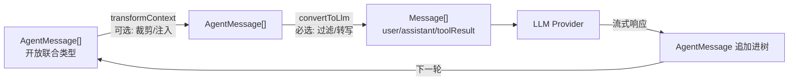
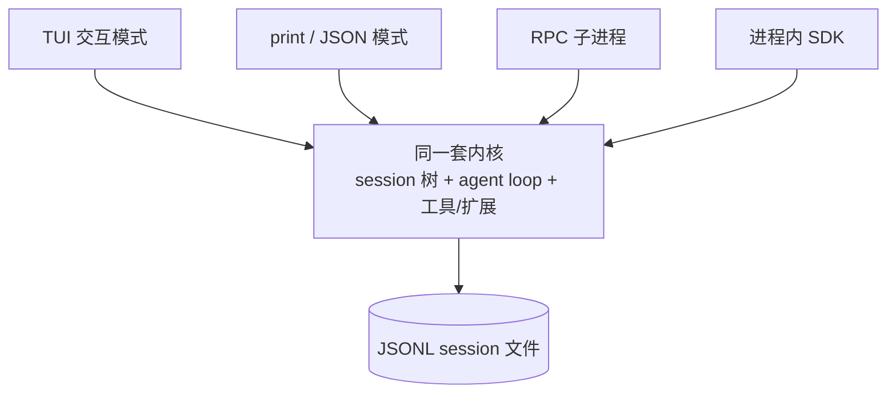
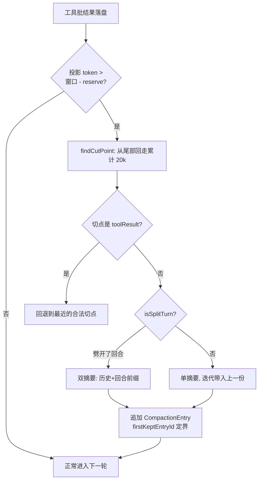
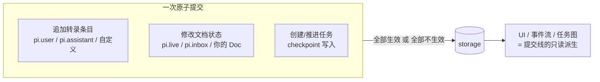
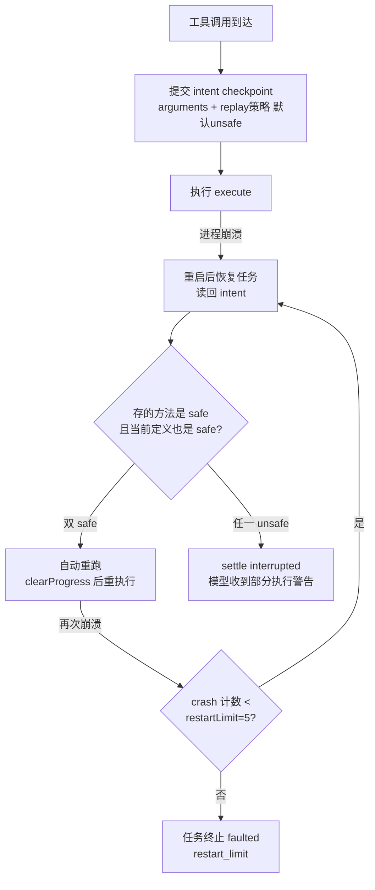
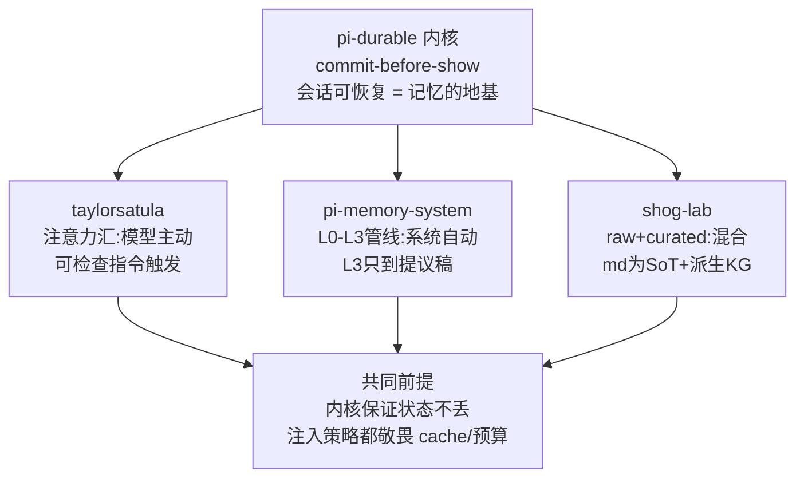
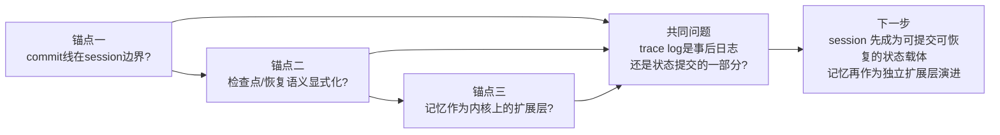

## 第 1 章 PI 的结构与两个设计原则

PI（pi coding agent）的自我定位只有两个词：**minimalism（极简）和 malleability（可塑）**。这两个词不是营销文案，是能在源码里逐条对账的设计契约——本章先立这两个原则、走一遍结构，后面四章的深度都建立在它们之上。

**Minimalism 的证据是"不做清单"**：pi 刻意不内置 sub-agents 和 plan mode，README 的原话是——

> Pi ships with powerful defaults but skips features like sub-agents and plan mode. **Ask Pi to build what you want**, or install a package that does it your way.

缺什么？让 agent 自己造，或者装别人造好的包。**Malleability 的证据是扩展点密度**：Extensions（TypeScript 模块，注册工具/命令/provider/事件/渲染）、Skills（按需加载的说明书）、Prompt templates、Themes，打包为 Pi Packages 经 npm/git 分发，pi.dev 维护公开目录。npm 生态里的 pi 包已经补齐了 README 刻意不做的全部功能——sub-agents、沙箱、后台任务、SSH、记忆扩展。"砍功能"砍出的空位成了生态的生长点：**内置了，社区只能做"配置"；不内置，社区才能做"实现"。**


### 1.1 结构：六层 monorepo

- **pi-ai**：模型接入层——多 provider 流式、重试、模型目录。注意它是**库而非框架特性**：模型路由（virtual models 甚至支持"一个可选模型按请求挑物理模型"）都建在这层，不含 agent 逻辑；
- **pi-agent-core**：agent loop 本体（1.2 节拆解）；
- **pi-coding-agent**：CLI、默认工具集、session 管理、扩展系统；
- **pi-durable**：可恢复的持久化 harness（第 3 章主角）；
- **chord / pi-tui**：插件热重载宿主运行时 / 终端 UI。

分层的意义不在模块化审美，在**替换边界的显式化**：loop 不知道 session 存在，session 不知道 CLI 存在。信任模型也划在这一层：`project_trust` 事件闸住项目级扩展和 skill 的加载——可塑性的闸门，没有信任边界就没有安全的可塑。


### 1.2 loop 的真实形状：60 行骨架

minimalism 的终极证据是 loop 本体。`agent-loop.ts` 全文 960 行，真正的循环只有 `runLoop` 一个函数，骨架（保留真实控制流）：

```typescript
while (true) {                                  // 外循环：只为 follow-up 续跑存在
  let hasMoreToolCalls = true;
  while (hasMoreToolCalls || pendingMessages.length > 0) {   // 内循环：一次响应+一个工具批
    if (lastCompletedTurn) {
      const snap = await config.prepareNextTurn?.(lastCompletedTurn);  // ① 压缩在这里发生
      if (pendingMessages.length === 0)
        pendingMessages = (await config.getSteeringMessages?.()) || [];  // 压缩期间打的字不丢
      await emit({ type: "turn_start" });
    }
    for (const m of declareToolChanges(currentContext, msgs)) {        // ② 工具增减补丁(第2章)
      currentContext.messages.push(m);
    }
    await config.prepareRequest?.(ctx, signal);                        // ③ 最后的改写机会
    const message = await streamAssistantResponse(...);                // ④ 流式响应
    if (message.stopReason === "error" || message.stopReason === "aborted") {
      await emit({ type: "agent_end", messages: newMessages });
      return;                                                          // ⑤ 错误是硬出口,恢复责任在外层
    }
    // ⑥ 执行工具批 → hasMoreToolCalls 决定是否继续内循环
  }
  const followUps = (await config.getFollowUpMessages?.()) || [];
  if (followUps.length > 0) { pendingMessages = followUps; continue; }
  break;
}
```

三处细节值得盯住：steering 消息在压缩后**补收一次**（打断不丢消息）；`error/aborted` 是硬出口——loop 只推进不救火，恢复责任推给外层（第 3 章）；外循环 6 行代码只为 follow-up 存在，换来"提交即排队"的编程模型。

上下文进 LLM 前有两道变换，签名即语义：

```typescript
transformContext?: (messages: AgentMessage[], signal?) => Promise<AgentMessage[]>;  // 可选：裁剪/注入
convertToLlm: (messages: AgentMessage[]) => Promise<Message[]>;                     // 必选：过滤/转写
```

`AgentMessage` 是开放联合类型（应用可塞自定义 role），session 持久化前者、模型看到后者——**树内语义与 LLM 语义在这里解耦**，第 2 章的压缩、第 4 章的记忆注入都活在这条缝隙里。



### 1.3 一套内核，四个表面

pi 有四种驱动方式：交互式 TUI、print/JSON 一次性模式、RPC 子进程（语言无关集成、IDE）、进程内 TypeScript SDK——**全部驱动同一套 session + loop + 机器**，连扩展渲染的终端 UI 都能在 RPC 子进程里继续工作。这不是"一个 CLI 附带 SDK"，而是**SDK 是产品本体，CLI 只是其中一个客户端**。



对做 SDK 的人，这是 pi 结构上最值得带走的一个观点：**把"驱动方式"做成内核之上的可替换客户端，而不是把内核埋进一个产品进程里。**

### 1.4 可塑性的机制证据

malleability 不靠口号，靠四个机制（本章只立论点，细节归第 2、3 章）：

- **Skills 目录/正文分离**：启动只注入 name+description，全文按需 read——常驻成本一条 description；
- **Tool 三通道结果**（content 给模型 / details 给 UI / structuredContent 给程序化调用方）+ 运行时随时装卸，装卸以补丁进 transcript 不破 cache（第 2 章）；
- **规模化靠索引**：工具声明有 token 预算（装不下走 BM25 检索 + deferred 提拔），MCP server 挂几十个也不撑爆上下文；
- **codemode**：一个让模型写 JS 批量调其他工具的工具——"用代码调工具"，pi 生态杀手级的胶水层。

### 1.5 一个 harness 的克制清单

| pi 不内置 | pi 交付 | 换来的 |
|---|---|---|
| sub-agents | 扩展点 + 包生态 | 多种实现方案竞争 |
| plan mode | 极小的核心 loop（1.2 的骨架） | 可整体替换的心智模型 |
| 记忆组件 | session 树 + custom entry + compaction | 记忆成为数据模型问题（第 4 章） |
| 权限系统 | 信任边界 + OS 权限复用 | 更少的抽象层 |

这就是传统软件几十年炼出来的纪律——**小内核、清晰边界、组合优于配置**——在 agent harness 上的一个高质量落地。

### 本章要点

- 两个原则可对账：minimalism 看不做清单，malleability 看扩展点密度；
- loop 骨架 60 行、两道上下文变换解耦树内与 LLM 语义——后续所有机制的地基；
- 四个表面驱动同一内核：SDK 是本体，CLI 是客户端；
- 结构分工预览：session 管"记住"（第 2 章），durable 管"不丢"（第 3 章），记忆生态管"什么值得留"（第 4 章）。

---

## 第 2 章 Session 树：上下文的数据模型

大多数 agent 的上下文管理是"一维"的：一条消息数组，满了就截断或摘要。pi 的出发点不同——**上下文的底层是一棵树，所有上下文操作都是这棵树上的指针移动，而不是数据改写。** 这一个决定同时解决了分支、压缩、缓存三个问题，也为第 3 章的崩溃恢复和第 4 章的记忆提供了地基。


### 2.1 会话是一棵树

Session 是 JSONL 文件，每个条目带 `id` 和 `parentId`；当前条目到根的路径是**活跃分支**，它才是下一次模型请求的历史：

```typescript
interface SessionEntryBase {
  type: string;            // session / message / compaction / custom ...
  id: string;              // 8 位 hex
  parentId: string | null; // 根为 null
  timestamp: string;
}
```

三个直接后果：

- **分支零成本**：`/tree` 回到任意历史节点重新提交，旧分支原样保留——不是"撤销重来"，是"另开一条路"；
- **改写即分支**：编辑旧消息重新提交，pi 不修改任何条目，只新建指向旧节点的子条目——历史完整性天然保证；
- **切分支不丢结论**：离开一条做了大量工作的分支时，pi 自动摘要它挂到目标分支上——放弃路径，保留结论。

**每一步只追加、只移动指针。** 这个性质贯穿全文：恢复 = 重放树路径（第 3 章），记忆跟随分支（第 4 章），cache 前缀永不改写（本章 2.3）。

### 2.2 Compaction：在树上做精确手术

上下文逼近窗口（`contextTokens > contextWindow - reserveTokens`，默认 reserve 16k）时自动压缩。切点选择的真实算法（`compaction.ts`）：

```typescript
export function findCutPoint(entries, startIndex, endIndex, keepRecentTokens): CutPointResult {
  const cutPoints = findValidCutPoints(entries, startIndex, endIndex);
  // 从最新条目向回走，累加估算 token（默认 keepRecentTokens = 20k）
  let accumulatedTokens = 0;
  let cutIndex = cutPoints[0];
  for (let i = endIndex - 1; i >= startIndex; i--) {
    accumulatedTokens += estimateEntryTokens(entries[i]);
    if (accumulatedTokens >= keepRecentTokens) {
      // 取"该位置或之后"最近的合法切点；尾部工具结果自己超预算时，
      // 保留它前面的 assistant 工具调用，而不是退回第一条消息
      cutIndex = cutPoints.find((c) => c >= i) ?? cutPoints[cutPoints.length - 1];
      break;
    }
  }
  // 切点不是回合起点 → 劈开了一个回合（isSplitTurn）
  const startsTurn = isTurnStartEntry(entries[cutIndex]);
  return { firstKeptEntryIndex: cutIndex, turnStartIndex: ..., isSplitTurn: !startsTurn && ... };
}
```

"合法切点"的定义是压缩安全性的核心：

```typescript
function isCutPointMessage(message: AgentMessage): boolean {
  switch (message.role) {
    case "user": case "assistant":
    case "bashExecution": case "custom":
    case "branchSummary": case "compactionSummary":
      return true;
    case "toolResult":
      return false;   // 铁律：永远不在工具结果处切——它必须和调用它的 tool call 待在一起
  }
  return false;
}
```

切点劈进超长回合时（一次提交引发的多轮工具调用），pi 生成**两份摘要**——历史摘要 + 被劈回合的前缀摘要——再合并，"正在进行的任务"不被拦腰斩断。

**摘要是条目，不是替换**：

```typescript
export interface CompactionEntry<T = unknown> extends SessionEntryBase {
  type: "compaction";
  summary: string;             // 固定结构: Goal/Progress(Done/In Progress/Blocked)/Key Decisions/Next Steps/Critical Context
  firstKeptEntryId: string;    // 从哪个条目开始保留
  tokensBefore: number;
  usage?: Usage;               // 生成摘要这次 LLM 调用也被记账
  fromHook?: boolean;          // session_before_compact 钩子生成的
  systemMessage?: SystemMessage; // 压缩边界的完整 prompt+工具状态快照
}
```

模型看到 `summary + firstKeptEntryId 之后的消息`；旧条目一字节不动，`/tree` 随时回到压缩前的完整历史。摘要格式是**迭代式**的：下一次压缩把上一份摘要作为输入，要求"PRESERVE all existing information... UPDATE the Progress section"——这就是 pi 的"会话内记忆"收敛机制（第 4 章的插件会接管它做记忆提取）。



### 2.3 补丁式系统消息：prompt cache 的底层保障

session 的第一条系统消息持久化完整的 prompt 分区 + 工具清单；**之后的一切变化都以补丁形式追加**。实现是每次请求前的 `declareToolChanges` 差分：

```typescript
const changes = getToolStateChanges(
  getCurrentTools([...context.messages, ...baseline]),   // transcript 已声明的工具集
  (context.tools ?? []).map(toToolDeclaration),          // runtime 实际可执行的集合
);
// 差分写进系统消息的 toolsAdded / toolsRemoved；重放补丁序列必得当前工具集
```

函数注释的原话就是设计承诺："Before each request the difference becomes `toolsAdded` and `toolsRemoved` on a system message... so **replay always yields exactly `context.tools`**."——没有独立维护的"prompt 状态"，状态与历史不可能不一致；cache 视角下，历史前缀永不改写，变化只发生在尾部。


这条纪律的账单散布在 pi 的 changelog 里（1.0→1.4 十几条修复同属一个主题）：Anthropic 同名工具重定义改为对话内联定义；摘要请求不带 thinking 块（重放的 thinking 不在活跃上下文里，带着它摘要请求比被摘要的上下文还大）；切模型丢弃旧模型 thinking；resume 恢复会话期间激活的工具集；Kimi Code 换官方协议只因"中途加工具不清缓存"。**前缀即资产**——pi 把"不动历史前缀"当作与正确性同级的约束，长会话里 cache 命中直接决定成本和延迟。

### 本章要点

- 树是根：条目只追加、分支/压缩全是指针操作；切点铁律 + split-turn 双摘要是压缩的精确性；
- 补丁式系统消息实现"改工具不破 cache"：重放必得当前状态，没有状态与历史的缝隙；
- 树的可重放性是下一章的地基：崩溃恢复 = 重放树路径，记忆 = 树上的条目。

---

## 第 3 章 pi-durable：执行内核——"什么才被承认是已发生的"

pi-durable 不是 pi coding agent 的一个模块，而是一个**并存的通用 Agent harness**：与 coding agent 共用 pi-ai，独立解决另一类问题——当 Agent 要跑在任意宿主上、承受崩溃、被中断时，**执行本身该如何被持久化**。

它的全部设计收敛在一条原则上：

> **先提交，后可见（commit before show）。**

一次提交可以同时完成三件事：追加转录条目、修改文档状态、创建任务——要么全部生效，要么全部不生效。UI、事件流、任务图都只是这条提交线的派生物。进程在任何一毫秒死掉，重开时看到的世界都是"最后一次提交"的一致状态：**"已显示但未持久化"这个状态类别，在 pi-durable 里不存在。**


### 3.1 一次 run 在存储里的样子

第 2 章的树是数据模型，pi-durable 给它装上执行语义。一次普通问答的持久化形态（README 直出）：

```text
submit(input) → pi.user
  pi.generation → pi.system (仅当 prompt/工具变化时), pi.assistant (工具调用)
    pi.tool × n → pi.tool-result × n   (generation 拥有这些 tool 任务并等待它们)
  pi.generation → pi.assistant (最终回答) → submission done
```

**run 不是函数调用，是一棵任务树。** `pi.generation` 任务调模型、拥有自己的 `pi.tool` 子任务、等待它们完成。除了内置任务，你自己的后台工作也是同构的任务——这就是为什么它自称 harness 而不是库。

一次提交里的三类写入（转录条目、文档、任务创建）在同一个事务里生效：



### 3.2 Task 状态机：没有进展就 fault

所有 Task 都是显式状态机：phase 列表 + checkpoint。规则说起来只有一句——**每个 phase 结束前，必须提交一个与进入时不同的 checkpoint**。看真实代码（`scheduler.ts` 的 `#rules()`，调度器每步的判定序列）：

```typescript
#rules(current: ErasedRunningTask, previous: PhaseResult | undefined): StepPlan {
  // 3. abort 标记：结束
  if (current.abortRequested) return END;
  // 4. 未捕获异常：fault
  if (previous.failure !== undefined) return { kind: "fault", error: previous.failure.error };
  // 6. 没有持久化进展：
  if (jsonEqual(current.state.checkpoint, previous.checkpoint)) {
    const message = `Task ${current.kind} phase ${previous.checkpoint.phase} returned without durable progress`;
    return { kind: "fault", error: new Error(message) };
  }
  return PROGRESS;
}
```

读点在 `jsonEqual`——**JSON 深比较**，不是引用比较。你在 phase 里"做了事"（调了模型、写了文件）但没把任何变化写进 checkpoint，调度器直接把任务判为 `faulted`。这条规则堵死了"假成功"：一个任务不能声称完成了工作却拿不出持久化的证据。**进展的证明责任在任务本身，不由框架推断。**

GenerationTask 的真实 phase 代码里能看到这个契约的用法（第 2 章引用过，这里看 checkpoint 字段）：

```typescript
if (threshold === "blocking") {
  await runtime.commit(async (tx) => {
    const child = await createCompaction(tx, conversationId, { reason: "threshold" }, runtime.taskId);
    // checkpoint 记录了:回到哪个 phase、第几次尝试、在等谁
    const checkpoint = { phase: "prepare", attempt, compacted: child, threshold: true };
    return { status: "waiting", checkpoint, on: [child], policy: "allSettled" };
  }, context);
}
```

任务不"调用"子任务，而是**提交一个等待状态然后结束本次执行**。崩溃后从 checkpoint 恢复，看到 `waiting` 就去查子任务结果。phase 顶部重跑（phase 内没有持久 sleep），所以每个 phase 必须幂等——所需状态全在 checkpoint 里，这是任务作者的责任。

### 3.3 Replay：显式契约，而不是事件重放

崩溃恢复的经典路线是 Temporal 式事件重放：记录全部输入事件，重放历史重建状态。pi-durable 选了另一条路——**不重放历史，把"副作用能否重做"变成开发者的显式声明**。

机制分两步。**执行前**，工具调用的意图（最终参数 + replay 策略）先行提交进 checkpoint（`tool.ts`）：

```typescript
await runtime.commit(() => {
  const intent = { phase: "execute", arguments: final, replay: tool.replay ?? "unsafe" } as const;
  return { status: "running", checkpoint: intent };
}, context);
await run(runtime, task.input, call, tool, final, context);   // 这之后进程才可能死
```

**恢复时**，重跑与否由"保存的策略"和"当前的工具定义"**共同**决定：

```typescript
/** Recovery after intent: rerun only when the stored and the current policy both say `safe`. */
execute: async (task, runtime, context) => {
  const { arguments: args, replay } = task.state.checkpoint;   // 崩溃前存下的意图
  const tool = await resolveTool(runtime, task.input, call.name, context);
  if (replay === "safe" && tool?.replay === "safe") {
    // 存的意图是 safe 且现在的定义仍是 safe → 自动重跑
    return run(runtime, task.input, call, tool, args, context);
  }
  // 否则:不重跑,模型拿到 interrupted 错误
  const message = `Tool ${call.name} was interrupted and may have partially run`;
  await settleFromSlot(runtime, task.input, call, { tool }, { status: "failed", message }, "interrupted", message, context);
},
```

三个设计判断值得展开：

- **默认值是 `unsafe`**（`tool.replay ?? "unsafe"`）——保守缺省：没声明重放语义的工具，崩溃后一律不自动重跑。`read` 这类纯读工具声明 `"safe"`，`bash`/付款类默认不重跑；
- **双 safe 判定防的是"定义漂移"**：意图提交于崩溃前，工具定义属于崩溃后。代码作者改了工具的行为（比如给 `bash` 加了副作用），旧 checkpoint 里的 safe 不能单方面决定重跑——两边都点头才放行；
- **与 Temporal 的对比**：事件重放要求全部输入可重放、全部副作用通过 activity 抽象隔离；pi-durable 的显式契约把决定权放在每个工具的声明里，换来的是不要求"整条历史可重放"。两种路线的取舍：Temporal 买确定性，pi-durable 买显式性和轻量。

**双 safe 之外还有一道熔断**：即使是 safe 重放，连续被崩 `restartLimit` 次（默认 5）也终止任务；且计数是宿主级的——"Every task running when a process dies is counted, not only the one that killed it"，同进程的旁观任务同样计入。恢复机制自己也需要熔断，否则确定性杀进程的 bug 会把"无限恢复"变成无限烧钱。



### 3.4 单写者边界：诚实的非分布式

pi-durable 的并发模型一句话可以说完：**一个进程独占一份存储，没有跨进程锁。** 多客户端（比如另一个进程想看进度）是 attach 到这个进程——`readOnly: true` 打开存储，所有写操作直接拒绝 `ReadOnlySession`——而不是多进程同时写。

这是边界条件而不是缺陷：提交线的原子性在单进程内自洽，跨进程协调（分布式锁、共识）是完全另一个量级的问题。pi-durable 的选择是把"进程内一致性"做到极致，把分布式问题留给宿主（比如 Cloudflare Durable Object 本身就是单写者原语）。对借鉴者的意义：**这套机制的价值区间是"单进程长任务"，不要指望它解决多写者。**

### 3.5 确定性重放：沙箱内长任务的恢复正解

工具粒度的 replay 契约解决不了一个问题：一条正在 QuickJS 沙箱里跑的 codemode 脚本，本身是内存态，进程死在中间怎么办？pi-durable 的答案写在 `codemode.ts` 文件头（原话节选）：

> The VM only runs when the host hands it a result; given the same start data, clock, seed, and results in the same order, it makes the same calls with the same arguments... **from a journal written before each delivery**.

五个构件：

1. **确定性 VM**：虚拟时钟、种子化随机数、UTC——同输入必同执行路径；
2. **journal**：`pi.codemode.journal` 文档，每个交付给脚本的结果**交付前**先写入；
3. **重放**：重启后重跑脚本，按原顺序递还 journal 结果，脚本做出一模一样的调用，按 key（`c<VM call id>`）挂回嵌套任务——已完成的调用绝不重跑；
4. **计数对账**：每次 drain 的调用数被提交后才放行新调用，"上次尝试可能已放行的调用"集合有上界；
5. **分岔守卫**：脚本走了和 journal 不同的路径、VM 指纹变了、超时——任一命中直接报错终止，不硬续。

README 还给了这条设计的价签："A sequential script therefore costs one journal commit and one count commit per result... **that is the price of checking the most common crash point.**"——每个工具结果两次额外提交，明码标价。

### 3.6 为什么有了 40 个 hook，还需要内核任务机

pi 的扩展事件面有 40 个 hook：`before_agent_start`、`tool_call`、`before_provider_request`、`session_before_compact`……覆盖了从信任决策到流式渲染的一切。那为什么还需要一个内核级任务机？

因为 **hook 是进程内的观察与拦截，任务机是存储内的强制契约**。hook 的生命周期等于进程的生命周期：进程死了，hook 注册的回调连同它想做的任何事一起消失。而 checkpoint 写在提交线里：任务"停在哪、下一步是什么"是存储状态，不依赖任何进程活着去"记得"它。

一句话：**hook 解决"运行时能不能看见"，任务机解决"崩溃后凭什么继续"。** 这是从可观测到可恢复的那条线——第 5 章会回到它。

### 本章要点

- pi-durable 是执行内核：唯一原则 commit-before-show，转录/文档/任务在同一原子提交里；
- checkpoint 硬规则：phase 返回时 checkpoint 与进入时 JSON 深比较相同 → 直接 faulted（"returned without durable progress"），假成功在机制上不可能；
- replay 是显式契约：意图先行提交，恢复时**保存的策略与当前定义双 safe** 才重跑，默认 unsafe；外层还有宿主级熔断（restartLimit=5）；
- 单写者边界：一进程一存储，多客户端只读 attach——价值区间是单进程长任务；
- 沙箱内长任务用确定性重放（虚拟时钟 + journal + 分岔守卫），每结果两次提交是明码标价。

---

## 第 4 章 记忆插件生态：内核之上的"什么值得留"

先立一个分层判断：**pi 的记忆管理不是 pi-durable 内置的功能，而是建立在持久化内核之上的插件生态。** 这些插件共享一个共同假设——因为 pi-durable 保证了会话状态在崩溃后可恢复、跨会话可持续存在，记忆才有可能被可靠地写入和召回。**内核做"不丢"，记忆层决定"什么值得跨会话保留、如何组织和召回"。**

pi 本体对记忆的供给只有四件地基（第 2 章都见过）：树形 session（append-only、可重放）、custom entry（`codemode-store` 就是官方示例——记忆跟随分支）、compaction 结构化摘要（Goal/Progress/Key Decisions 的固定格式 + `session_before_compact` 钩子）、handoff（跨会话交接）。没有 memory 工具，没有向量库。于是生态里长出了三种性格迥异的实现。


### 4.1 @taylorsatula/pi-durable-memory：注意力汇——把"什么时候存"变成可检查的指令

**存储**：`node:sqlite` 单文件 `memory.db`，AES-256-GCM 加密是菜单选项（但 embedding 向量永不加密——加密内容无法检索）；可选挂一个只读的团队共享库，`surface` 时合并检索、写入永远只进本地库。

**两步循环**是它的全部灵魂。会话以 `op: "surface"` 开场（检索与本次工作相关的记忆）；每完成一个任务，调用 `op: "checkpoint"`——它**不接受任何内容参数，只返回一段固定的指令文本**，指示模型把 create/edit/delete/helpful 批量打进下一次调用：

```text
═══ CHECKPOINT — RECORD WHAT YOU LEARNED ═══

You just completed a unit of work. Batch the following into ONE call:

1. `create` — facts no readable text supplies. ... Carry the verification
   condition — the checkable path, string, or command whose change proves
   the row stale; an unfalsifiable row is a belief.

   ... Two tests before recording: WHEN does this next fire, WHAT kills it?
   Either unanswered — no call.

2. `helpful` — rate every id `surface` showed you and you have not rated...

`op` labels the call and selects nothing: every array in it applies...

The next task begins with `surface`; call `checkpoint` again when it is
complete, and after every commit.
```

这段设计的精妙处在源码注释里写得直白：

> Task-scoped, not session-scoped: a model cannot observe "the session is ending", but it can observe "the task is done".

**触发条件刻意写成模型可以对照转录执行的可检查指令**——"任务完成了吗"是模型能观测的状态，"会话要结束了"不是。对比大量记忆产品的"当你觉得这个信息重要时存下来"（模型永远无法可靠执行的判断），这是把触发器从模型的主观状态搬到了转录的客观事实上。保存判据同样可检查：每条记忆必须带"验证条件"（哪条路径/字符串/命令变了证明它过期），过不了 "WHEN fires / WHAT kills it" 两问就不许写。

还有一个防御性细节值得抄：`applyMutations` 对**任何** op 都执行（包括 surface/checkpoint），因为观察发现模型会分两次 checkpoint 调用（第一次打分、第二次写记忆）——如果按 op 门控，这就是静默数据丢失。

**短板自述**（README "Known limits"）：无衰减机制、向量明文、内存全量扫描（几千条内可用）、记忆不按项目分域。

### 4.2 pi-memory-system：L0–L3 管线——全自动的"无感"路线

这是一条**模型不主动参与**的路线：后台管线把对话逐步整理成记忆，主代理只在回答时消费。四层分工（官方架构文档直出）：

| 层 | 职责 | 关键机制 |
|---|---|---|
| L0 对话归档 | 只保留净化后的用户/助手正文，按天 jsonl | **字节偏移游标**——读取进度精确落在 JSONL 行末尾，崩溃后从断点继续 |
| L1 原子记忆 | 提炼可独立复用的事实/任务/方法/资产 | 每 **10 次交互输入**触发一次后台提取；提取→批量查重→**独立模型价值复核**→统一提交；单条 300 字符预算 |
| L2 工作场景 | 把相关原子记忆组织成有背景的场景块 | L1 积压排空且有新记忆才安排；新建/更新/合并/归档 |
| L3 用户画像 | 从场景归纳长期偏好 | 触发条件表驱动（显式请求/首次/累计30条…）；**每次只改一条**、正式 `USER.md` 只读、写入 `USER-temp.md` **提议稿，用户手工并入才生效** |

三个设计点值得注意：

- **查询构造有检索价值判断**："同意""提交"这类推进词不含检索主题，改用最近一条有实质内容的消息替代（必要时用助手上一条回复——推进类指令的真实意图常写在助手那边）。这解决的是"拿废话去查向量库"的经典浪费；
- **项目加权**：同项目的记忆不打折、明确属于其他项目的打七五折、无项目的通用件保持原分——"通用经验换个项目依然成立，不能因为不属于当前项目就不告诉主代理"；
- **L3 的信任边界**：画像全自动但**生效永远需要人**——管线写到提议稿为止。自动化的终点是提议，不是决定。

**治理短板**：提取和整理对用户不可见（黑盒程度最高），且目前仅支持 Windows（子代理进程树语义 + 盘符路径的项目归属判断）。

### 4.3 @shog-lab/pi-memory：raw + curated 两层——可检查的知识库

灵感自注是 Karpathy 的 LLM Wiki："knowledge as flat markdown the LLM curates itself"。三层结构：

```
.pi-mind/
├── raw/           追加式事件流（什么发生了）
│   ├── sessions/  conversations
│   ├── observations/  agent 注意到的事
│   └── maintenance-log/  内部操作 jsonl
├── knowledge/     策展知识（什么为真）—— 同时是知识图谱的 SoT
│   └── *.md       frontmatter + body + triples 字段
└── .pi-mind-index.db   SQLite 派生索引（FTS5 + 向量 + kg_* 表，每次 sync 从 frontmatter 重建）
```

**关键判断：KG 是派生物，markdown 是 SoT。** 每条知识的 frontmatter 带 `triples: [["maria", "owns", "auth-service"]]`，`knowledge-graph.ts` 把它索引成带时序的 Triple（`valid_from/valid_to/current/confidence`——时序知识图谱语义与 Zep 同构），但图永远可以从 markdown 重建。这避免了"图数据库成为第二个真相源"的一致性灾难。

**注入策略**：L1 级条目（高优先偏好/决策）永远注入（预算 2000 token）；L2 按相关度检索（FTS5 + 向量，相似度阈值 0.3，`[[链接]]` 解析连带加载）；总注入预算 4000 token。向量化走本地 Ollama，5 秒超时自动降级 FTS5——**检索永不因为 embedding 服务挂掉而失败**。

**治理是它最重的笔墨**——agent 拥有对自己知识的完整工具链：

- `knowledge-lint`：schema 校验、自动修复、重复检测、过期标记、`--prune`（**默认 dry-run**，`--apply` 才真删）；
- `memory-audit`：agent 执行的审计技能——扩展在 `before_agent_start` 注入"审计逾期"提示，**由 agent 决定何时执行**（无守护进程，一切 piggyback 在交互节奏上）；
- `promote-memory`：把检索到的记忆提议晋升为人类文档（AGENTS.md/README），用户批准才写入；
- 自动遗忘：每 50 次写入触发一次；保留策略按类型分级——`user/project` 永不自动删，`agent-feedback` 60 天，`reference` 90 天。

### 4.4 三派对照与选型推演



| 维度 | taylorsatula 注意力汇 | pi-memory-system L0-L3 | shog-lab raw+curated |
|---|---|---|---|
| 记忆产生 | 模型主动（checkpoint 循环） | 系统自动（后台管线） | 混合（raw 自动 + curated 主动策展） |
| 知识形态 | 自包含句子 + 验证条件 | 原子→场景→画像分层 | triples 知识图谱 + markdown SoT |
| 检索 | embedding 相似度（全量扫描） | 向量召回 + 项目加权 | FTS5+向量+图，多级降级 |
| 注入 | surface 按需检索 | 快照 + 每轮自动注入 | L1 常驻 + L2 按需（4000 预算） |
| 治理/信任 | 可检查指令；两问测试 | 黑盒最高；L3 到提议稿为止 | **agent 可 lint 自己的知识**；审计+晋升 |
| 依赖 | embedding 服务 | 仅 Windows | Ollama + better-sqlite3 |
| 适合场景 | personal agent 长期陪伴 | 无感自动化、用户零负担 | 知识密度高、需可审计的工程场景 |

**选型推演**（按 agent 形态对号入座）：

- **个人助理型**（长期陪伴一个用户）→ 抄 taylorsatula 的**可检查触发**。"模型什么时候该存"是最容易烂掉的一环，把触发器绑在"任务完成"这种可观测事实上，比任何"觉得重要就存"的提示词都可靠；
- **团队知识工作型**（知识密度高、需要审计）→ 抄 shog-lab 的**两层结构**。markdown 作为 SoT + 派生索引，兼顾人类可读可审计与机器可检索；lint/audit/promote 三件套是治理完整度最高的实现；
- **pi-memory-system 的管线**是体验最好、治理最弱的一档，适合作为 **L1 补充**（自动提取原子事实）而不是记忆主体；它的**查询价值判断和项目加权**两个点独立于整体架构，任何方案都值得偷；
- **共同前提**回到第 3 章：三家都默认"会话状态可恢复、跨会话可持续"——如果 session 底座做不到这一点，任何一派的记忆插件都建在沙滩上。

### 本章要点

- 分层是主论点：pi-durable 负责"不丢"，记忆插件负责"什么值得留"——两者不是并列组件而是地基与上层建筑；
- 三派 = 三种"记忆产生权"的分配：模型主动（可检查触发）/ 系统自动（管线+提议稿）/ 混合（raw+curated 双层）；
- 选型按 agent 形态：陪伴型抄触发器、知识型抄两层结构、自动化管线做补充；无论哪型，先确认内核给了记忆一个稳定地基。

---

## 第 5 章 给自研 Agent SDK 的三个架构锚点

全文的机制都讲完了，这一章只回答一个问题：**如果你在维护一套自研 Agent SDK（有自己的 session、trace log、hook 机制），pi 的这些设计里哪些值得纳入你的架构视野？** 三个锚点，每个都是"PI 的做法 → 追问你的现状 → 一个可执行的检查项"——不需要更换框架，但需要诚实回答。

### 锚点一：commit 线是否存在于 Session 边界

**PI 的做法**：pi-durable 的全部状态变更走一条原子提交线——转录条目、文档状态、任务进度在同一个事务里生效（第 3.1 节）。"已显示但未持久化"的状态类别不存在。

**追问你的 SDK**：如果你有 session 和 trace log，需要追问：一次 session 内的状态变更，是否存在**原子提交语义**——转录、任务进度、文档状态要么一起生效，要么都不生效？如果写入是分散的（trace log 一处、任务状态一处、文档一处），崩溃恢复时就可能面对"对话记录显示工具已调用，但任务状态显示尚未执行"的**撕裂**。

**检查项**：确认你的 trace log 目前是"事后日志"还是"状态提交的一部分"。判据很简单：进程在任意一点被 kill 后重启，trace log 与任务状态是否能互相对账——对不上，就没有 commit 线。

### 锚点二：检查点与恢复语义需要显式化

**PI 的做法**：两层契约。内核层，phase 返回时 checkpoint 必须与进入时不同，否则 `faulted`（"returned without durable progress"，第 3.2 节）；工具层，replay 是显式声明，恢复时双 safe 才重跑（第 3.3 节）。外加宿主级熔断防 crash loop。

**追问你的 SDK**：多数 SDK 的 hook 机制是在执行过程中拦截——但 hook 之外，**任务进度本身是否有一个强制持久化的契约**？Agent 在工具调用中途崩溃，重启后是靠模型"看 trace log 猜"上次做到哪，还是有明确的检查点告诉调度器"这个任务停在了哪个 phase、下一步该做什么"？

第 3.6 节的区分在这里就是判定标准：hook 是进程内的观察与拦截，生命周期等于进程；检查点是存储内的强制契约，不依赖任何进程活着。**从"可观测"走向"可恢复"，中间隔的就是这条线。**

**检查项**：拿一个真实的两步任务做注入实验——在工具调用中途 kill 进程，重启后问三个问题：上次停在哪？哪些副作用可能已经发生（replay 语义）？重试会不会重复已完成的副作用？三个问题答不上来，恢复语义就还是隐式的。

### 锚点三：分层关系比记忆插件本身更值得借鉴

**PI 的做法**：记忆是插件生态不是内核功能——但三家插件共享同一假设：会话状态可恢复、跨会话可持续（第 4 章）。内核做"不丢"，生态做"什么值得留"。

**追问你的 SDK**：不必急于实现一套 pi 式记忆插件。更有价值的判断是：**你的 SDK 是否已经为"跨会话持久知识"提供了可靠的状态底座？** 如果 session 状态本身在崩溃后不可恢复，任何记忆插件都建在不稳定的地基上——记忆的写入和会话状态一样会撕裂、会丢。反过来，如果 session 和 trace log 能被改造为**可提交、可恢复的状态载体**，记忆管理就可以作为一个独立的扩展层演进，而不是被绑进内核。

**检查项**：按第 4.4 节的选型表对号入座我们的 agent 形态（陪伴型抄可检查触发 / 知识型抄两层结构 / 管线做补充），然后把"记忆写入是否跟随 session 的提交语义"列入记忆方案的验收标准——不是"存进数据库了吗"，而是"崩溃后能像会话一样恢复吗"。



### 收束

pi-durable 回答的是"**Agent 的工作在崩溃后凭什么继续**"，记忆插件回答的是"**跨会话的智能凭什么积累**"。前者是基础设施问题，后者是产品能力问题。对任何在维护自研 Agent SDK 的团队而言，最紧迫的借鉴不在记忆插件的多样性，而在 pi-durable 那条提交线所代表的架构纪律——**状态变更的原子性、检查点的强制性、恢复语义的显式契约**。这三件事不需要更换框架，但会决定一套基础设施能否支撑下一代 Agent 应用对"持久性"的要求。
